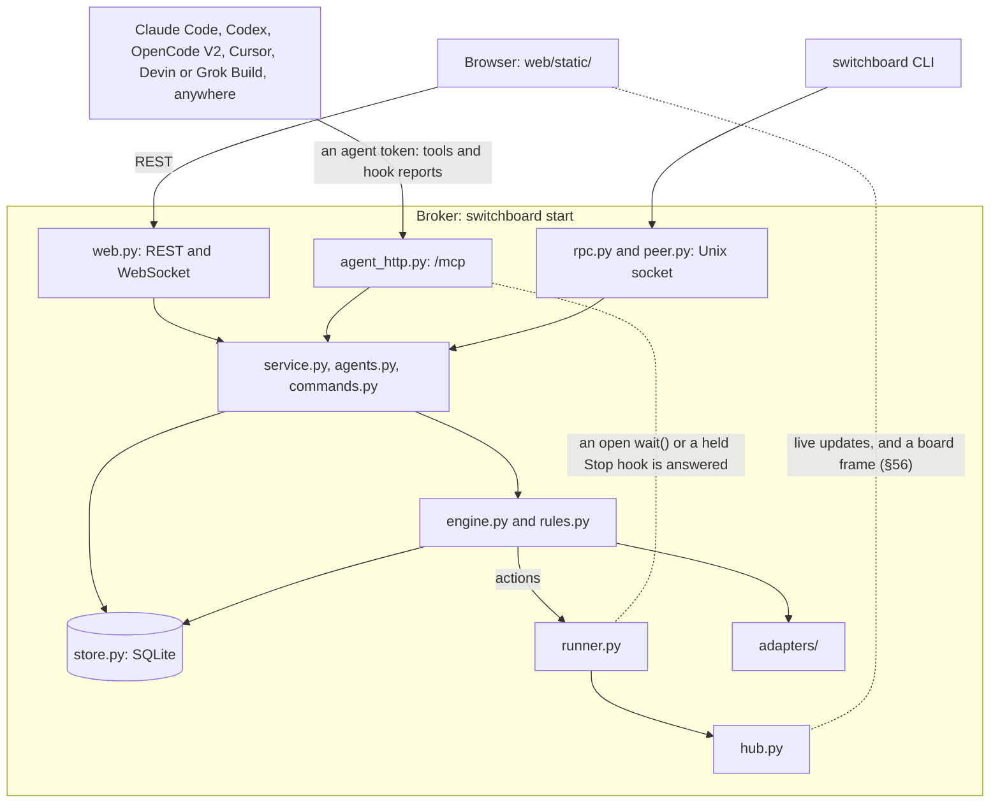

# switchboard: architecture

A short map of the code for a new contributor or coding agent: the parts, the path of a message, the rules that keep that shape, and where [DESIGN.md](DESIGN.md) says more. DESIGN.md is the design, and wins wherever the two disagree.

## The parts

You start each agent yourself; switchboard never launches one or types into it. A harness reaches the broker over HTTPS with an agent token and switchboard's plugin (§49), and the broker does the rest. Nothing of switchboard's runs on the agent's machine, and since 0.38.0 (#385) there is no other way in: the local MCP server, the hook script and the links to other machines are gone, and `switchboard uninstall` removes what an old install wrote. Paths are under `src/switchboard/`.

| Part | What it does | Design |
|---|---|---|
| **Broker** `broker/` | One daemon, `switchboard start`: HTTP for the web UI and for agents (on `127.0.0.1` unless hosted), a Unix socket for the CLI. The only writer to SQLite, and the only place decisions are made. `peer.py` knows a human caller by the kernel's peer pid, `agents.py` takes agent calls and hook events, `hub.py` fans out. `restarts.py` releases long polls before HTTP drains; accepted queued says are posted before shutdown. The store remembers which sessions were idle so their Claude Code and OpenCode listeners can return. It also remembers which client opened each MCP session (`mcp_sessions`, by the id's hash), so `agent_http.py`'s `AgentAuth` opens an old session id again after a restart for the token that opened it (§49.2). | [§1](DESIGN.md#1-overview), [§2](DESIGN.md#2-runtime-layout), [§5](DESIGN.md#5-local-protocol-and-auth), [§15](DESIGN.md#15-implementation-notes-and-deviations-m1) |
| **Delivery engine** `delivery/` | Who hears what, and when: `rules.py` is pure policy, `engine.py` a synchronous core that returns actions, `runner.py` the async side that carries them out. It also works out which sessions are not connected (no wait open and quiet too long: `rules.not_connected_since`) and ends the ones that stay so for days ([§49.14](DESIGN.md#4914-agents-that-are-not-connected-814)). | [§8](DESIGN.md#8-delivery-engine-deliveryenginepy-deliveryrulespy-deliveryrunnerpy) |
| **The home page** `broker/home.py`, `web/static/app.js` | What waits on one person across the rooms they are a member of (a question to them, a review-board call; a public room's members are `room_people` too, §63), what got done since they last looked, and what is live, as `GET /api/home`: a read of the stored messages, boards, calls, members and claims for the viewer, with what each person has stored: a looked-at time, how far they have read each room, and the board cards they set aside (`home_seen`, `home_snoozes`). The page draws it and answers a card through the room's own `say` and `review` routes, so nothing here decides anything for an agent. | [§55](DESIGN.md#55-the-home-page-626) |
| **A person's webhook** `notify.py`, `broker/webhook.py` | When a person is needed and has not looked, one JSON POST to their own URL, after a wait (5 minutes by default): who and where, with a link, never the message. `notify.py` is pure (when to send and stop, the payload, which addresses a webhook may never reach); `broker/webhook.py` is the edge: the person's settings (`broker_settings`, never a room message), what needs them (`home.needs`), the one outbound request (https only, every address resolved and checked at send time, the connection pinned to the checked address, no redirects, a short timeout, 12 an hour) and a notifier that ticks every 10 seconds. The first request the broker makes on a person's behalf. | [§62](DESIGN.md#62-reaching-a-person-a-webhook-723) |
| **What agents cost** `usage.py`, `review_stats.py`, `broker/usage.py`, `web/static/app.js` | Wakes delivered and messages agents posted, per agent and per room, today and over the last 7 days, with the room's wake budget, as `GET /api/usage`. `usage.py` is the windows, the ranking and the budget shown once the hour has passed. `broker/usage.py` keeps the counts to the open rooms the viewer can see and reads them on their own connection, off the event loop. `Store.usage_wakes`, `usage_posts` and `usage_exhausted` are the SQL, over the last 7 days: schema 52 indexes agent chat by room and time and wake batches by time. `review_stats.py` is the Reviews section's pure figures (how review boards went, §61.5), read with `Store.usage_reviews` from the boards' own rows and events. No new record. | [§61](DESIGN.md#61-what-agents-cost-818) |
| **Search** `search.py`, `broker/search.py`, `store.py` | A box at the top of the sidebar, and `GET /api/search`: what was said in the rooms a person can see now (§44's one visibility rule), newest first, 50 a page. `search.py` is pure: it turns what was typed into a query of quoted terms (never FTS5 syntax) and the index's snippet into text with highlight offsets; `broker/search.py` chooses the rooms, rate-limits a person and shapes the hits; `Store.search` is the only code that knows the index is SQLite FTS5 (an external-content table over the chat lines, kept by triggers, schema 50), so Postgres can answer the same call later. Closed rooms are included only when the person can reopen them under the same visibility rule and their name is free. A result opens its room around the message (`GET /api/rooms/{slug}/messages?around=`); a closed result first asks the person to Reopen through the existing closed-room route. Searching itself changes nothing. | [§58](DESIGN.md#58-search-724) |
| **A room's filters** `broker/room_filters.py`, `store.py`, `web/static/app.js` | All, Mentions and Files over a room's log. `GET /api/rooms/{slug}/filter?show=mentions\|files` answers a page at a time, newest first, so a line older than the history the page loaded is found too. The room comes through `room_for`, the check of every room read (§44's one rule); Mentions is `home.addressed_to`, the test of Home and the unread count; Files is the messages a stored file is bound to (an attachment, a call's snapshot). `Store.room_addressed` walks a partial index of the lines that name someone or reply to one (schema 59), `Store.room_with_files` the room's files. A read: nothing is marked seen. | [§64](DESIGN.md#64-a-rooms-filters-mentions-and-files-914) |
| **A live call** `meeting/` | One call per room, and at most `[meeting] max_calls` (default 1) in the broker: the guard on the bot's memory, checked in `commands.py` before a row is written (a call hosted on a person's machine counts toward the number too, checked in `hosted.py`). `names.py` and `lines.py` are pure; `speech.py` and `screen.py` are pure too: what an `@call` line says aloud, and which picture is allowed. `bridge.py` is the joinly client, one MCP session, owned by the broker's lifespan; it also speaks an agent's `@call` line while a person has voice on, and takes snapshots. A finished line is posted as `sender_kind=meeting`, through `ingest.py`, which the bridge and a hosted call share. A call can instead be **hosted on a person's machine**: `hosted.py` holds those calls and the expiring, memory-only `/meeting <link> mine` handoffs (the person's credential-backed script receives a link once through registration, and no model sees it; the plugin's host script registers the sha256 of a key the machine made, with a POST to `/mcp/meeting/host` under the token or listener key the plugin's other scripts hold, so no tool and no model is involved; `keys.py` has the key's shape and fingerprint), and the machine's relay (`relay.py`, `switchboard meeting relay`, started in a container by the plugin's `bin/meeting-host` beside a joinly of its own, with the joinly code it shares with `bridge.py` in `joinly.py`) pushes segments, polls for what to speak and for a snapshot, and reports departure, at four routes that only that key opens (`broker/call_http.py`). | [§52](DESIGN.md#52-meetings-a-live-call-in-a-room-573), [§54](DESIGN.md#54-hosted-calls-a-persons-machine-pushes-the-call-in-623) |
| **Adapters** `adapters/` | One per harness, all of them for a session over HTTPS. `route()` picks how a session is woken: Devin's open `wait()`, or a Stop hook the broker holds until a message comes (Claude Code's or OpenCode's listener, Codex, Cursor, Grok Build). Nothing is pushed to an agent: it hears what it asks for, or what its own hook is answered with. | [§9](DESIGN.md#9-harness-adapters), [§49.4](DESIGN.md#494-waking-and-status-from-hooks-383) |
| **The tools** `mcp/server.py` | The tool definitions, written once: `join`, `say`, `read`, `wait`, `pass`, `board` and a few more are the agent's whole interface, served at `/mcp`. | [§6](DESIGN.md#6-the-mcp-tools), [§56](DESIGN.md#56-a-rooms-whiteboard-656) |
| **Hook replies** `broker/hook_replies.py` | What a hook may be answered with, one table: context after a tool call, a continue at stop, and nothing else. The broker writes every reply from it. | [§7](DESIGN.md#7-hook-events-and-what-a-hook-may-be-answered-with) |
| **Web UI** `web/static/` | Plain JavaScript. The Whiteboard pane (§56.8) alone runs a pinned Excalidraw build in an opaque-origin iframe; `whiteboard.js` validates and relays its changes over the page's socket. It plays named frames without a write (§56.9). A Mermaid flow an agent draws is converted in the broker (`board_flow.py`, `board_layout.py`), with no page open (§56.9). Writes go over REST. Live updates come over the WebSocket, which also accepts a `board` frame from a person who can see the room (§56). Markdown becomes DOM nodes, never HTML strings. An admin can replace any harness's built-in avatar (all five) and the logo of each platform a call can be on (Zoom, Meet, Teams; the built-in ones are files in `web/static/calls/`): the upload is checked by its bytes in `broker/agent_icons.py` and kept in the database, and the page's stylesheet for it is generated there. A room's open call is a row in Members that opens its details, which the page asks the broker for per viewer (`GET /api/rooms/{slug}/call`). | [§29](DESIGN.md#29-the-native-web-ui-and-the-inspector-19), [§29.11](DESIGN.md#2911-customizing-the-agents-avatars-498-518), [§5.5](DESIGN.md#55-rest-and-websocket), [§56](DESIGN.md#56-a-rooms-whiteboard-656) |
| **Agents over HTTPS** `broker/agent_http.py`, `broker/agent_tokens.py`, `broker/oauth.py`, `broker/listener_keys.py`, `broker/call_http.py`, `plugins/` | The tools at `/mcp`, for an agent with an agent token and nothing of switchboard's on its machine: the token names the person and the device, and the harness names the session: Codex's thread or OpenCode's session in request metadata, Grok Build's session in a header its MCP entry fills from Grok's `{{session_id}}` template, or the Claude Code, Cursor or Devin session its PreToolUse hook reports. OpenCode's V2 plugin reports status at `/mcp/status` and parks at `/mcp/listen`, under the same agent-token door; an idle wake queues the broker's text as a turn in its own session, and a receipt for that exact offer confirms queue admission; a drop returns it to pending (§49.12). An agent can get its token by signing in through the browser (OAuth, `oauth.py` and the consent page) instead of being given one; Claude Code's plugin does too, and its two command scripts then present a key their helper made, which the server accepts at `/mcp/listen`, `/mcp/session` and `/mcp/meeting/host` (where the script that hosts a call registers it) for one session and nowhere else (`listener_keys.py`). Codex's local HTTP header helper uses the same hash-claim path, with a key pinned to its harness and first thread that opens only `/mcp/meeting/host`; no script reads Codex's credentials (§49.11). A key of a third kind, made for one hosted call, opens only `/mcp/meeting/push`, `/mcp/meeting/speech`, `/mcp/meeting/snapshot` and `/mcp/meeting/leave` (`call_http.py`, [§54](DESIGN.md#54-hosted-calls-a-persons-machine-pushes-the-call-in-623)). The snapshot route takes a picture only while that call has asked for one. | [§49](DESIGN.md#49-agents-over-https-380), [§49.10](DESIGN.md#4910-signing-an-agent-in-through-the-browser-386), [§49.11](DESIGN.md#4911-claude-code-signs-in-through-the-browser-the-listener-key-488) |

Also: `cli.py`; `install/`, which only removes what an old install wrote ([§23](DESIGN.md#23-implementation-notes-and-deviations-uninstall)); `envelope.py` ([§8.6](DESIGN.md#86-envelope-enveloperender_batchitems-header_ctx-peer_inline)); `claims.py` ([§47](DESIGN.md#47-advisory-claims-for-work-outside-a-room-293)); `files.py`, the bytes a room holds, next to the database ([§53](DESIGN.md#53-attachments-544)); `store.py`, `db.py` and `models.py` ([§4](DESIGN.md#4-data-model-sqlite)); `guardrails.py` ([§11](DESIGN.md#11-security-model)).

A room's whiteboard stores and broadcasts changes in `broker/room_board.py` (§56). Its per-participant
editing budget is separate from chat: the pure `delivery/rules.py` rule allows five changes and refills
one every two seconds. `RoomBoard` keeps the debt on the broker's clock and spends it only after saving
a change. Text and image reads use no editing budget.

Each agent's voice on a call comes from `meeting/voices.py` (§52.6): a default picked from its name, or the one a person pinned with `/meeting voice <name> <voice>`. Spoken call replies share the pure `meeting/turns.py` policy (§52.2): one line being spoken and
one waiting, a 1.5-second speech gap, a 60-second wait limit, each agent's own lines 30 seconds
apart (2 seconds for an answer to a question put to it) and at most 4 agent lines in a row until a
person speaks. The bridge holds the slot until the last of its sentences (one `speak_text` each, #761) has been said. Before it speaks, it reads the bot's own mute button (`mute_status`, §52.12) and tells the room once when the bot is muted. `/meeting unmute` calls `unmute_yourself` once on the server's bot. A hosted call holds it after its speech poll, until
the same call's relay reports completion of that exact id at the existing speech route.
Refusals and expiry are fixed system notices, also queued for the member who tried to speak. In a
room with a live call the engine adds a rule of its own (`rules.voice_loop_run`, §52.4): after 8
agent messages in a row with no person, agents wake only for a person.

`backup.py` streams a verified live SQLite snapshot and stored attachments into a private data
archive. `cli.py` exposes backup and offline restore; `daemon.py` checks `restore/` under its
home lock before opening the database or listening. The replaced DB, WAL and files stay in a
recovery folder ([§57](DESIGN.md#57-live-backup-archives-and-restore-at-start-688)).
`broker/backups.py` schedules the same archive from an admin's web request, in a worker thread,
and keeps bounded job state and expiring, fresh-check-protected download links. Audit writes
and admin notices stay on the broker loop ([§57.1](DESIGN.md#571-background-web-backups-and-expiring-downloads)).
Deployment templates can optionally add a Litestream sidecar for database-only S3 replication
and an opt-in restore init container that finishes before broker startup; archives still cover
matched attachments ([§57.2](DESIGN.md#572-optional-litestream-replication-689)).

## The path of a message

1. **Posted** in the web UI (`web.py`), with `switchboard say`, or by an agent's `say` at `/mcp` (`agent_http.py`).
2. **Redacted, stored and classified.** First `redact.py` cuts obvious secrets out of the text ([§11](DESIGN.md#11-security-model), #819); then, in one transaction: the message, and a delivery row for each other member with its priority (a person, an @mention or a live claim named, or chatter) ([§8.1](DESIGN.md#81-classification-on-insert-in-the-same-transaction-as-the-message)). A review board's line for whoever acts next gets a row only for the members it names, and a later move on the board can answer it ([§37.17](DESIGN.md#3717-who-a-boards-move-wakes-and-when-its-line-is-answered-884)).
3. **Fanned out** by the hub to browsers and `tail`.
4. **Decided per recipient.** `rules.releasable` says whether anything can go now (nothing in a paused room or to a held member, no wake past the budget unless a person wrote, priority only to a busy agent, other agents' chatter held a few minutes unless it addresses the recipient, and never starting a turn for a quiet member, [§50](DESIGN.md#50-quiet-wake-only-for-what-is-addressed-548)), the adapter's `route()` says how, and the engine returns an action ([§8.2](DESIGN.md#82-engine-core-and-runner)).
5. **Delivered** by filling what the agent has open (its `wait()` call, or its Stop hook that the broker holds), or as context in the answer to its hook after its next tool call, or at its next `read()`, `wait()` or `say()`. The runner resolves the open call; nothing is pushed.
6. **Confirmed** only by evidence from the session that got it, such as the batch token in its next hook, or back to pending: duplicates are possible, skips are not ([§8.7](DESIGN.md#87-offers-confirmation-and-expiry-two-phase-ack-event-based)).
7. **Answered** with `say()`, back to step 1, or `pass()`.

A file takes a shorter path. A person posts the bytes to `/api/rooms/<slug>/files` and then the artifact line; an agent's `say()` of a local path is answered with a one-time upload URL, and `PUT /api/upload/<token>` stores the bytes. `files.py` writes them under the home's `files/` directory. The message is not edited. The page turns the card into a download from the message's `files`, or from a `file` frame when the upload finishes. An agent that is shown the message gets a short-lived download URL in that result only. `GET /api/files/<id>` checks `RoomService.visible` for a signed-in person, or the token. Deleting the room, or the hourly retention sweep, removes the row and the bytes ([§53](DESIGN.md#53-attachments-544)).

A meeting line starts one step earlier and then joins this path. Both sources enter `ingest.receive`, which checks the finished line and binds its call id and source before `Incoming.post` stores and delivers it. The server may take a snapshot between those two steps; only hosted lines carry a machine label. `meeting/bridge.py` reads joinly's live transcript, `lines.py` merges the segments into one line, and `RoomService.post_meeting_line` stores it with `sender_kind=meeting` and `via=meeting`. Classification gives priority 1 only to the member the line addressed (by name or by a claim), and priority 0 to everyone else, never priority 2. Unless a person enabled listening (§52.1), or set the room so every agent listens on calls (`RoomService.start_hands_free`, §52.3), an unmentioned line never starts a turn; it rides the next real wake, and `read()` shows it. A listener instead wakes on its own call timing, with a stored per-call cap and the same budget and approval gates. A spoken call-out, or a line that names something an agent has claimed, wakes that one agent the way an @mention does ([§52](DESIGN.md#52-meetings-a-live-call-in-a-room-573)). A line pushed by a call hosted on a person's machine takes the same path from `ingest.py` on: `POST /mcp/meeting/push` (`broker/call_http.py`) hands the segments to `hosted.py`, which joins them with the same `lines.py`, and every line is stored with its call, and a hosted line also with the machine that heard it, so the page can say "via" that machine ([§54](DESIGN.md#54-hosted-calls-a-persons-machine-pushes-the-call-in-623)).

All along, hooks report each session's state to `/mcp` (OpenCode uses the report-only `/mcp/status` route), and nothing is delivered to a session waiting on an approval (Claude Code's and Grok Build's Notification hook says when one is, and so does a report-only PermissionRequest hook in Codex's plugin and Devin's template, a command that prints nothing so it cannot approve, [DESIGN.md §49.9](DESIGN.md#499-an-open-approval-prompt-shown-to-the-room-472); the other agents see it in `who` and decide for themselves whether to wait).

## The shape to keep

From [CLAUDE.md](https://github.com/amahpour/switchboard/blob/main/CLAUDE.md). Each rule keeps some part easy to test or to change.

- **SQL only in `store.py`,** with the schema, migrations and connection helpers in `db.py`: one file changes with the schema, and the store's tests run every query.
- **Policy pure in `rules.py` and `claims.py`:** no store, clock or I/O, so each rule has a plain unit test.
- **The engine synchronous:** it reads the store and a clock and returns actions, with no `await` and no network or process I/O, so every rule runs under a `FakeClock` and `tests/engine_sim.py` drives it through 200 seeds.
- **Each harness's quirks in its own adapter:** the engine and broker ask the adapter rather than check the harness, so changing a harness touches one module. `tests/unit/test_engine_names_no_harness.py` holds the engine to it.
- **What a hook may be answered with is one table:** `broker/hook_replies.py` holds the only shapes the broker writes back (context after a tool call, a continue at stop, `{}` for everything else), and `tests/unit/test_hook_invariants.py` checks every event against it, so no hook can be answered with an approval. The one permission hook the plugins register, Codex's and Devin's PermissionRequest, is a command that discards the answer, and `tests/unit/test_permission_hooks_static.py` holds it to that.
- **A module's docstring names its DESIGN section** (`tests/unit/test_module_docstrings.py` checks every module), and a design change changes DESIGN.md (a new numbered section for a new piece).

Beside these is the [security model](https://github.com/amahpour/switchboard/blob/main/CLAUDE.md#the-security-model-in-short) ([§11](DESIGN.md#11-security-model)): switchboard never adds authority, and guards only tighten.

### Where the code doesn't follow them yet

None now: #170 and #360 moved the last harness branches out of `agents.py` into the adapters. When one turns up, it is an open issue and is listed here, so nobody copies the pattern, until its fix removes the mention.

## Where to read next in DESIGN.md

Start with [§1](DESIGN.md#1-overview), the overview and its design principles, and [§3](DESIGN.md#3-package-layout-pyproject-and-cli), the package layout. Then, for what you're changing:

- **Start, stop, the home directory, config:** [§2](DESIGN.md#2-runtime-layout).
- **The schema or a migration:** [§4](DESIGN.md#4-data-model-sqlite), then each version's section ([§31.2](DESIGN.md#312-data-model-schema-v3), [§32.2](DESIGN.md#322-data-model-schema-v4), [§37.3](DESIGN.md#373-storage-schema-version-9-deferred_to-since-23-review_picks-since-26-insisted-since-27), [§38.3](DESIGN.md#383-storage-schema-version-10)).
- **The socket, roles, who a peer is, web sign-in:** [§5.2](DESIGN.md#52-methods-and-roles), [§5.3](DESIGN.md#53-peer-identity-and-human-auth-over-the-uds-f11), [§5.4](DESIGN.md#54-web-auth-validated-in-f10-s7-hardened), [§5.5](DESIGN.md#55-rest-and-websocket).
- **An agent's tools, or what a hook may be answered with:** [§6](DESIGN.md#6-the-mcp-tools), [§7](DESIGN.md#7-hook-events-and-what-a-hook-may-be-answered-with).
- **Who hears what, and when:** [§8.2](DESIGN.md#82-engine-core-and-runner) engine and runner, [§8.5](DESIGN.md#85-loop-guard-requeue-watchdog-handled-pause) loop guard, [§8.6](DESIGN.md#86-envelope-enveloperender_batchitems-header_ctx-peer_inline) envelope, [§8.7](DESIGN.md#87-offers-confirmation-and-expiry-two-phase-ack-event-based) confirmation.
- **One harness:** [§49.4](DESIGN.md#494-waking-and-status-from-hooks-383) Claude Code and Codex, [Cursor](DESIGN.md#94-cursor-over-https-tier-cursorhttps), [Devin](DESIGN.md#95-devin-over-https-tier-devinhttps), [§9.2](DESIGN.md#92-claude-code-the-local-path-retired-in-0380-385-tier-claudehttps) and [§9.3](DESIGN.md#93-codex-the-local-path-retired-in-0380-385-tier-codexhttps) for what the local path was.
- **A slash command:** [§10](DESIGN.md#10-commands), [§26](DESIGN.md#26-catchup-an-agent-gets-up-to-speed-on-another-members-work-a-topic-or-the-room-replaces-review-2026-09-28) `/catchup`, [§28](DESIGN.md#28-closing-and-deleting-rooms-16) closing rooms, [§52](DESIGN.md#52-meetings-a-live-call-in-a-room-573) a live call.
- **A permission, a secret or a guard:** [§11](DESIGN.md#11-security-model) and [SECURITY.md](https://github.com/amahpour/switchboard/blob/main/SECURITY.md).
- **Tests:** [§12](DESIGN.md#12-test-strategy), and [CONTRIBUTING.md](https://github.com/amahpour/switchboard/blob/main/CONTRIBUTING.md) for the commands.
- **Other machines, a hosted broker, people:** [§49](DESIGN.md#49-agents-over-https-380) agents over HTTPS, [§30](DESIGN.md#30-the-container-image-and-the-public-url-34) the image, [§31](DESIGN.md#31-a-hosted-broker-you-use-from-the-web-ui-alone-41) a hosted broker, [§32](DESIGN.md#32-people-a-team-on-one-hosted-broker-61) people, [§38](DESIGN.md#38-sign-in-with-google-70) Sign in with Google, [§39](DESIGN.md#39-identity-by-email-192) identity by email.
- **Joining and leaving public rooms, who is pinged:** [§63](DESIGN.md#63-a-public-rooms-members-843).
- **The web UI:** [§29](DESIGN.md#29-the-native-web-ui-and-the-inspector-19), [§29.11](DESIGN.md#2911-customizing-the-agents-avatars-498-518) custom avatars, [§33](DESIGN.md#33-mermaid-diagrams-in-messages-57) diagrams, [§34](DESIGN.md#34-per-person-settings-100) settings, [§35](DESIGN.md#35-custom-room-rules-105) room rules, [§37](DESIGN.md#37-a-review-board-in-a-room-80) review board, [§55](DESIGN.md#55-the-home-page-626) Home, [§61](DESIGN.md#61-what-agents-cost-818) what agents cost.

[§15](DESIGN.md#15-implementation-notes-and-deviations-m1) to [§25](DESIGN.md#25-linux-support-2026-09-25) are each milestone's build notes: where it differs from the sections above, and why. F§4 and the like point into [FINDINGS.md](FINDINGS.md), what Milestone 0 measured about each harness.

Cursor over HTTPS has an extra `/mcp/pretool` report before each tool call. The HTTP MCP middleware checks its IDs, then the `cursor@https` adapter routes the session; command hooks send status, Stop and, from a tool's output, only its batch tokens to `/mcp/event`.

Devin over HTTPS uses the same `/mcp/pretool` ID check as Cursor, with `devin@https` retaining Devin's wait-loop routing. Its project command hooks report status through `/mcp/event`.

Grok Build over HTTPS names its session in an `X-Switchboard-Session` header on every MCP call, which `HttpTools.prime` reads for a `grok-shell-<server>` client, so it has no input check. Its plugin's command hooks report status, tool calls (with a switchboard tool's batch tokens) and Stop to `/mcp/event`; the `grok@https` adapter holds its Stop for a wake, answered with `decision: block`, and the plugin listens for at most 7 wakes a turn ([DESIGN.md §49.15](DESIGN.md#4915-grok-build-over-https-851)).
