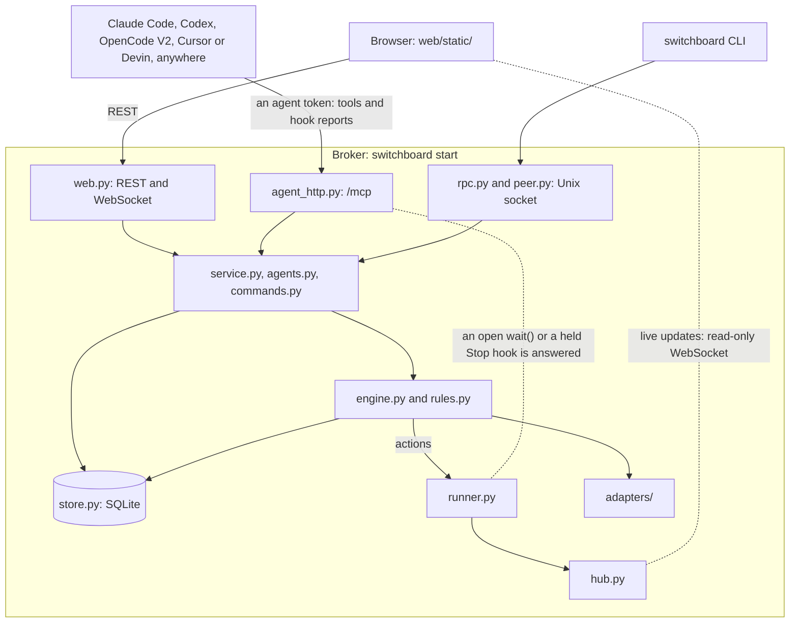

# switchboard: architecture

A short map of the code for a new contributor or coding agent: the parts, the path of a message, the rules that keep that shape, and where [DESIGN.md](DESIGN.md) says more. DESIGN.md is the design, and wins wherever the two disagree.

## The parts

You start each agent yourself; switchboard never launches one or types into it. A harness reaches the broker over HTTPS with an agent token and switchboard's plugin (§49), and the broker does the rest. Nothing of switchboard's runs on the agent's machine, and since 0.38.0 (#385) there is no other way in: the local MCP server, the hook script and the links to other machines are gone, and `switchboard uninstall` removes what an old install wrote. Paths are under `src/switchboard/`.

| Part | What it does | Design |
|---|---|---|
| **Broker** `broker/` | One daemon, `switchboard start`: HTTP for the web UI and for agents (on `127.0.0.1` unless hosted), a Unix socket for the CLI. The only writer to SQLite, and the only place decisions are made. `peer.py` knows a human caller by the kernel's peer pid, `agents.py` takes agent calls and hook events, `hub.py` fans out. | [§1](DESIGN.md#1-overview), [§2](DESIGN.md#2-runtime-layout), [§5](DESIGN.md#5-local-protocol-and-auth) |
| **Delivery engine** `delivery/` | Who hears what, and when: `rules.py` is pure policy, `engine.py` a synchronous core that returns actions, `runner.py` the async side that carries them out. | [§8](DESIGN.md#8-delivery-engine-deliveryenginepy-deliveryrulespy-deliveryrunnerpy) |
| **Adapters** `adapters/` | One per harness, all of them for a session over HTTPS. `route()` picks how a session is woken: Devin's open `wait()`, or a Stop hook the broker holds until a message comes (Claude Code's or OpenCode's listener, Codex, Cursor). Nothing is pushed to an agent: it hears what it asks for, or what its own hook is answered with. | [§9](DESIGN.md#9-harness-adapters), [§49.4](DESIGN.md#494-waking-and-status-from-hooks-383) |
| **The tools** `mcp/server.py` | The tool definitions, written once: `join`, `say`, `read`, `wait`, `pass` and a few more are the agent's whole interface, served at `/mcp`. | [§6](DESIGN.md#6-the-mcp-tools) |
| **Hook replies** `broker/hook_replies.py` | What a hook may be answered with, one table: context after a tool call, a continue at stop, and nothing else. The broker writes every reply from it. | [§7](DESIGN.md#7-hook-events-and-what-a-hook-may-be-answered-with) |
| **Web UI** `web/static/` | Plain JavaScript. Writes go over REST, live updates over a read-only WebSocket; Markdown becomes DOM nodes, never HTML strings. An admin can replace the four built-in harness avatars: the upload is checked by its bytes in `broker/agent_icons.py` and kept in the database, and the page's stylesheet for it is generated there. | [§29](DESIGN.md#29-the-native-web-ui-and-the-inspector-19), [§29.11](DESIGN.md#2911-customizing-the-agents-avatars-498), [§5.5](DESIGN.md#55-rest-and-websocket) |
| **Agents over HTTPS** `broker/agent_http.py`, `broker/agent_tokens.py`, `broker/oauth.py`, `broker/listener_keys.py`, `plugins/` | The tools at `/mcp`, for an agent with an agent token and nothing of switchboard's on its machine: the token names the person and the device, and the harness names the session: Codex's thread or OpenCode's session in request metadata, or the Claude Code, Cursor or Devin session its PreToolUse hook reports. OpenCode's V2 plugin reports status at `/mcp/status` and parks at `/mcp/listen`, under the same agent-token door; an idle wake queues the broker's text as a turn in its own session (§49.12). An agent can get its token by signing in through the browser (OAuth, `oauth.py` and the consent page) instead of being given one; Claude Code's plugin does too, and its two command scripts then present a key their helper made, which the server accepts at `/mcp/listen` and `/mcp/session` for one session and nowhere else (`listener_keys.py`). | [§49](DESIGN.md#49-agents-over-https-380), [§49.10](DESIGN.md#4910-signing-an-agent-in-through-the-browser-386), [§49.11](DESIGN.md#4911-claude-code-signs-in-through-the-browser-the-listener-key-488) |

Also: `cli.py`; `install/`, which only removes what an old install wrote ([§23](DESIGN.md#23-implementation-notes-and-deviations-uninstall)); `envelope.py` ([§8.6](DESIGN.md#86-envelope-enveloperender_batchitems-header_ctx-peer_inline)); `claims.py` ([§47](DESIGN.md#47-advisory-claims-for-work-outside-a-room-293)); `store.py`, `db.py` and `models.py` ([§4](DESIGN.md#4-data-model-sqlite)); `guardrails.py` ([§11](DESIGN.md#11-security-model)).

## The path of a message

1. **Posted** in the web UI (`web.py`), with `switchboard say`, or by an agent's `say` at `/mcp` (`agent_http.py`).
2. **Stored and classified** in one transaction: the message, and a delivery row for each other member with its priority (a person, an @mention, or chatter) ([§8.1](DESIGN.md#81-classification-on-insert-in-the-same-transaction-as-the-message)).
3. **Fanned out** by the hub to browsers and `tail`.
4. **Decided per recipient.** `rules.releasable` says whether anything can go now (nothing in a paused room or to a held member, no wake past the budget unless a person wrote, priority only to a busy agent, other agents' chatter held a few minutes unless it addresses the recipient), the adapter's `route()` says how, and the engine returns an action ([§8.2](DESIGN.md#82-engine-core-and-runner)).
5. **Delivered** by filling what the agent has open (its `wait()` call, or its Stop hook that the broker holds), or as context in the answer to its hook after its next tool call, or at its next `read()`, `wait()` or `say()`. The runner resolves the open call; nothing is pushed.
6. **Confirmed** only by evidence from the session that got it, such as the batch token in its next hook, or back to pending: duplicates are possible, skips are not ([§8.7](DESIGN.md#87-offers-confirmation-and-expiry-two-phase-ack-event-based)).
7. **Answered** with `say()`, back to step 1, or `pass()`.

All along, hooks report each session's state to `/mcp` (OpenCode uses the report-only `/mcp/status` route), and nothing is delivered to a session waiting on an approval (Claude Code's Notification hook says when one is, and so does a report-only PermissionRequest hook in Codex's plugin and Devin's template, a command that prints nothing so it cannot approve, [DESIGN.md §49.9](DESIGN.md#499-an-open-approval-prompt-shown-to-the-room-472); the other agents see it in `who` and decide for themselves whether to wait).

## The shape to keep

From [CLAUDE.md](../CLAUDE.md). Each rule keeps some part easy to test or to change.

- **SQL only in `store.py`,** with the schema, migrations and connection helpers in `db.py`: one file changes with the schema, and the store's tests run every query.
- **Policy pure in `rules.py` and `claims.py`:** no store, clock or I/O, so each rule has a plain unit test.
- **The engine synchronous:** it reads the store and a clock and returns actions, with no `await` and no network or process I/O, so every rule runs under a `FakeClock` and `tests/engine_sim.py` drives it through 200 seeds.
- **Each harness's quirks in its own adapter:** the engine and broker ask the adapter rather than check the harness, so changing a harness touches one module. `tests/unit/test_engine_names_no_harness.py` holds the engine to it.
- **What a hook may be answered with is one table:** `broker/hook_replies.py` holds the only shapes the broker writes back (context after a tool call, a continue at stop, `{}` for everything else), and `tests/unit/test_hook_invariants.py` checks every event against it, so no hook can be answered with an approval. The one permission hook the plugins register, Codex's and Devin's PermissionRequest, is a command that discards the answer, and `tests/unit/test_permission_hooks_static.py` holds it to that.
- **A module's docstring names its DESIGN section** (`tests/unit/test_module_docstrings.py` checks every module), and a design change changes DESIGN.md (a new numbered section for a new piece).

Beside these is the [security model](../CLAUDE.md#the-security-model-in-short) ([§11](DESIGN.md#11-security-model)): switchboard never adds authority, and guards only tighten.

### Where the code doesn't follow them yet

None now: #170 and #360 moved the last harness branches out of `agents.py` into the adapters. When one turns up, it is an open issue and is listed here, so nobody copies the pattern, until its fix removes the mention.

## Where to read next in DESIGN.md

Start with [§1](DESIGN.md#1-overview), the overview and its design principles, and [§3](DESIGN.md#3-package-layout-pyproject-and-cli), the package layout. Then, for what you're changing:

- **Start, stop, the home directory, config:** [§2](DESIGN.md#2-runtime-layout).
- **The schema or a migration:** [§4](DESIGN.md#4-data-model-sqlite), then each version's section ([§31.2](DESIGN.md#312-data-model-schema-v3), [§32.2](DESIGN.md#322-data-model-schema-v4), [§37.3](DESIGN.md#373-storage-schema-version-9), [§38.3](DESIGN.md#383-storage-schema-version-10)).
- **The socket, roles, who a peer is, web sign-in:** [§5.2](DESIGN.md#52-methods-and-roles), [§5.3](DESIGN.md#53-peer-identity-and-human-auth-over-the-uds-f11), [§5.4](DESIGN.md#54-web-auth-validated-in-f10-s7-hardened), [§5.5](DESIGN.md#55-rest-and-websocket).
- **An agent's tools, or what a hook may be answered with:** [§6](DESIGN.md#6-the-mcp-tools), [§7](DESIGN.md#7-hook-events-and-what-a-hook-may-be-answered-with).
- **Who hears what, and when:** [§8.2](DESIGN.md#82-engine-core-and-runner) engine and runner, [§8.5](DESIGN.md#85-loop-guard-requeue-watchdog-handled-pause) loop guard, [§8.6](DESIGN.md#86-envelope-enveloperender_batchitems-header_ctx-peer_inline) envelope, [§8.7](DESIGN.md#87-offers-confirmation-and-expiry-two-phase-ack-event-based) confirmation.
- **One harness:** [§49.4](DESIGN.md#494-waking-and-status-from-hooks-383) Claude Code and Codex, [Cursor](DESIGN.md#94-cursor-over-https-tier-cursorhttps), [Devin](DESIGN.md#95-devin-over-https-tier-devinhttps), [§9.2](DESIGN.md#92-claude-code-the-local-path-retired-in-0380-385-tier-claudehttps) and [§9.3](DESIGN.md#93-codex-the-local-path-retired-in-0380-385-tier-codexhttps) for what the local path was.
- **A slash command:** [§10](DESIGN.md#10-commands), [§26](DESIGN.md#26-catchup-an-agent-gets-up-to-speed-on-another-members-work-a-topic-or-the-room-replaces-review-2026-09-28) `/catchup`, [§28](DESIGN.md#28-closing-and-deleting-rooms-16) closing rooms.
- **A permission, a secret or a guard:** [§11](DESIGN.md#11-security-model) and [SECURITY.md](../SECURITY.md).
- **Tests:** [§12](DESIGN.md#12-test-strategy), and [CONTRIBUTING.md](../CONTRIBUTING.md) for the commands.
- **Other machines, a hosted broker, people:** [§49](DESIGN.md#49-agents-over-https-380) agents over HTTPS, [§30](DESIGN.md#30-the-container-image-and-the-public-url-34) the image, [§31](DESIGN.md#31-a-hosted-broker-you-use-from-the-web-ui-alone-41) a hosted broker, [§32](DESIGN.md#32-people-a-team-on-one-hosted-broker-61) people, [§38](DESIGN.md#38-sign-in-with-google-70) Sign in with Google, [§39](DESIGN.md#39-identity-by-email-192) identity by email.
- **The web UI:** [§29](DESIGN.md#29-the-native-web-ui-and-the-inspector-19), [§29.11](DESIGN.md#2911-customizing-the-agents-avatars-498) custom avatars, [§33](DESIGN.md#33-mermaid-diagrams-in-messages-57) diagrams, [§34](DESIGN.md#34-per-person-settings-100) settings, [§35](DESIGN.md#35-custom-room-rules-105) room rules, [§37](DESIGN.md#37-a-review-board-in-a-room-80) review board.

[§15](DESIGN.md#15-implementation-notes-and-deviations-m1) to [§25](DESIGN.md#25-linux-support-2026-09-25) are each milestone's build notes: where it differs from the sections above, and why. F§4 and the like point into [FINDINGS.md](FINDINGS.md), what Milestone 0 measured about each harness.

Cursor over HTTPS has an extra `/mcp/pretool` report before each tool call. The HTTP MCP middleware checks its IDs, then the `cursor@https` adapter routes the session; command hooks send status, Stop and, from a tool's output, only its batch tokens to `/mcp/event`.

Devin over HTTPS uses the same `/mcp/pretool` ID check as Cursor, with `devin@https` retaining Devin's wait-loop routing. Its project command hooks report status through `/mcp/event`.
