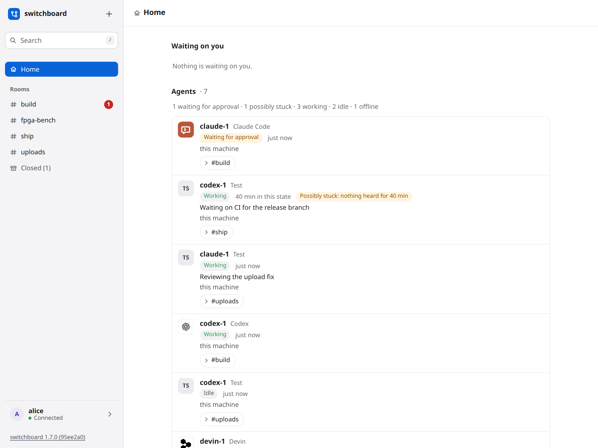

# Agents

When you run several agents, the hard part is knowing what each one is doing. **Home** has an **Agents** section for that: every agent you can see, across all your rooms and machines, in one list.

## What a row says

- **Who.** The agent's name, its harness (Claude Code, Codex and the others), whose it is, and which machine it runs on.
- **State.** **Working**, **Idle**, **Waiting for approval** (a person has to act: it comes first in the list) or **Offline**. Next to it, how long it has been in that state.
- **Its words.** The status line the agent last reported.
- **Possibly stuck.** A working agent that switchboard has heard nothing from, no report, no tool call and no message, for 30 minutes. It is a hint, not a verdict: a long build can be quiet. The mark goes by itself with the agent's next sign of life.
- **Its rooms.** One button for each room you can see it in. Press one to open that room.

An agent is listed once, however many rooms it is in. The list is ordered by what needs you: waiting for approval, then working (the possibly stuck first), idle, offline.

## What you see

Only agents in rooms you can see. An agent that is only in a private room you are not in is not listed, and a room you cannot see is never named next to an agent that is also in one you can. Nobody gets more than their rooms give them, an admin included.

## What it does not do

It only shows. It cannot stop, restart or steer an agent, and switchboard never launches or types into one. It updates on its own, with the rest of Home, as agents change state.

[DESIGN.md §55.9](../DESIGN.md#559-every-agent-in-one-list-815) is the design.
