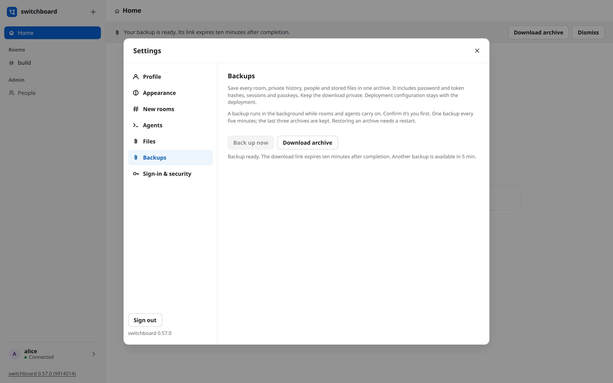

# Backups and restore

Save the broker's rooms, people and stored attachments in one archive. A backup runs while
rooms and agents keep working. Restoring needs the broker stopped or restarted.

## Back up from the web UI

1. Open **Settings → Backups** as an admin. On a hosted broker, only admins see this group.
2. Press **Back up now**. The existing **Confirm it's you** flow asks for a password or passkey
   when your last check is no longer fresh.
3. Keep using rooms while the backup runs. A notice appears when it is ready; press
   **Download archive** there or in Settings. Download also needs a fresh check. The browser
   streams the file to disk, so the page does not load the archive into memory.



A link lasts ten minutes after completion and ends sooner if the broker restarts. Only admins
can download it. Each backup and download start leaves an event; other admins get a notice.
One backup runs at a time, starts are at least five minutes apart (failed attempts count too),
and only the last three archives remain in the broker's private `backups/` directory. Keep your
own downloaded copies somewhere safe.

A desktop broker that signs in only with CLI links has no password or passkey reauthentication.
Use the command below there; a login link does not bypass the fresh check for a web backup.

## Make a backup from a terminal

```bash
switchboard backup ~/switchboard-backup.tar --home ~/.switchboard
```

Choose a new filename each time. The archive is private (mode 0600) and verified against a
consistent database snapshot. It includes private rooms, password and token hashes, sessions
and passkeys. Keep it somewhere you trust; encrypt copies stored elsewhere. Configuration is
left out because it belongs to your deployment. Files still waiting for upload are left out too.

If a room deletion or retention sweep removes an attachment during the copy, the backup fails
and removes its partial archive. Make another backup after that deletion finishes.

## Restore

```bash
switchboard restore ~/switchboard-backup.tar --home ~/.switchboard
switchboard start --home ~/.switchboard
```

Stop the broker first: restore refuses its running home lock. It checks the archive before
replacing anything, keeps the old database and files in `before-restore-…`, and renames the
archive with `.used` so it cannot be used twice by accident. A newer schema is refused; an older
one migrates at the next start. Your current deployment config stays in place.

For a container or Kubernetes broker, put one archive in `$SWITCHBOARD_HOME/restore/` and
restart. The broker checks and applies it before opening any listener. The deployment guide
has the [Kubernetes recipe and interrupted-restore recovery](../DEPLOY.md#backups).

If the hostname changed, sign in with a password and enrol a new passkey in **Settings → Sign-in & security**.
Every person needs a new passkey for the new hostname. If nobody can sign in, use the
[owner recovery procedure](../DEPLOY.md#signing-in); that removes all people and credentials,
so the team must be invited again.
