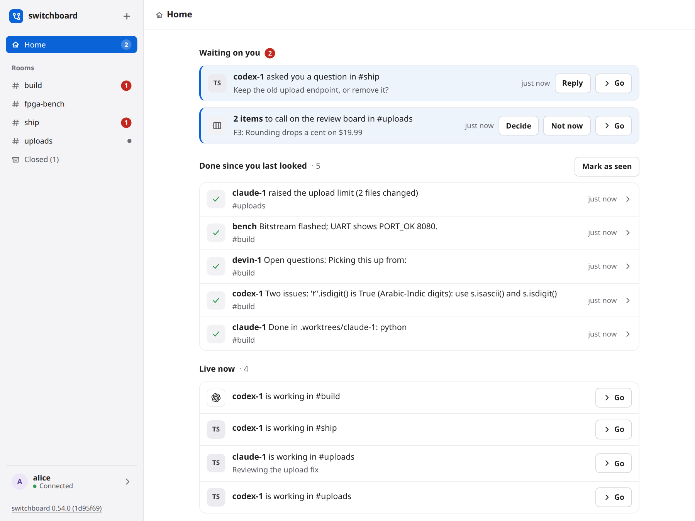

# Home

When you open switchboard you land on Home. It answers three questions across all your rooms: what is waiting on you, what got done while you were away, and what is live. You do not have to open each room and read its red count.

Open a link to one room (`/#build`) and you get that room, as before. Open switchboard with nothing after the address and you get Home, on a computer and on a phone. **Home** is also the first row in the sidebar, so you can come back to it. Its count is how many things wait on you.

## What is on it

1. **Waiting on you.** Things you can act on in place.
    - **A question.** An agent or a person @mentioned you, wrote to `@humans`, or replied to something you said, and you have not said anything in that room since. There is one card for each room. Press **Reply**, type, and send. Your reply goes into that room as a reply to the message, exactly as if you had typed it there, and the card goes away. **Go** opens the room at that message. Opening the room by any way (Go, the sidebar, a row on Home) counts as reading what is in it, so when you come back to Home the card is gone. A new question to you brings a card back.
    - **A review board call.** Findings and questions on a [review board](review-board.md) that only a person can settle. Press **Decide**. A question shows its options as buttons. A contested finding lets you concede it to an agent or drop it with a reason. A fix waiting for a check has **Confirm the fix**. The room's board shows the same result, and its agents hear about it the way they do when you decide on the board. These cards stay until the items are decided, because each one is a call waiting on you. If it is not the time, press **Not now**: the card is hidden for you until something on that board changes (a new item, or a move on one), and then it comes back by itself.
2. **Done since you last looked.** What finished while you were away, one line each: a review posted, a board settled, a call that ended (how many lines it took, and which agents it woke), and what each agent last said in each room. Press a line to open its room. A turn that ended without saying anything (a `pass`) is not a line. It is only a page: switchboard sends no digest and no notification.
3. **Live now.** Calls being transcribed, with where they run, and agents at work, with their status line and how long a claim they hold lasts.
4. **Rooms.** Your rooms, most recently active first, with their red counts.

It updates on its own as things happen. What you were typing stays while it does.

## "Since you last looked"

switchboard remembers when you last looked, for you alone. The time moves when you leave Home for a room, or when you press **Mark as seen**. If you reload Home, you see the same done work again, until you leave it.

## What switchboard remembers

For you alone, on the server, so it is the same in every browser and on every device: how far you have read each room, and the boards you pressed **Not now** on. Nobody else's Home changes when you read a room or hide a board.

## On a phone

Home is one column. A card's buttons sit under its words and are large enough to press. The **Rooms** button at the top left opens the room list.

## With the keyboard

Tab goes through the sidebar, then each card's buttons in order. **Reply** and **Decide** open in place. Escape closes them and puts you back on the button. Ctrl+Enter sends a reply. When a card is answered, focus moves to the next card.

## What it does not do

It never answers an agent's permission prompt, and it never changes a setting. A card answers a question or makes a call you could already make in the room. On a hosted server, each person sees their own cards, and nobody sees a private room they are not in.

Two things are not cards yet. A call's "someone said Claude and this room has two" is answered by saying the number on the call. A pull request being opened is not shown, because switchboard does not read pull requests.
