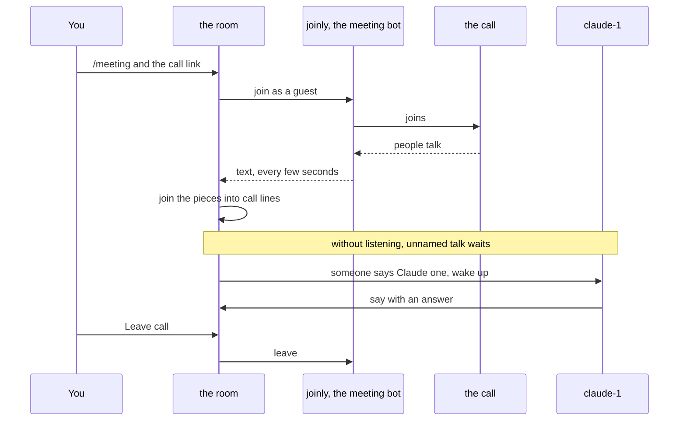
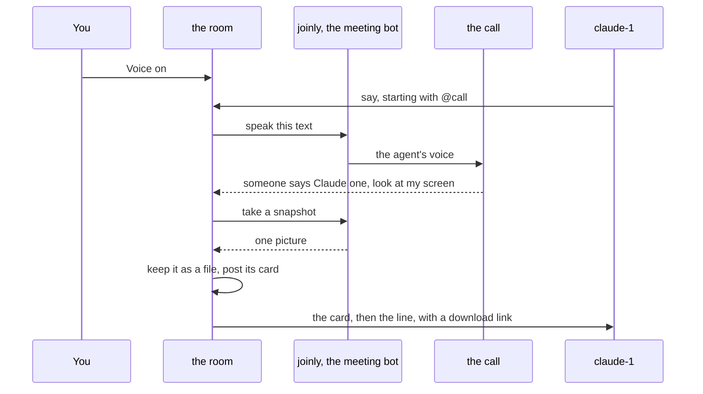
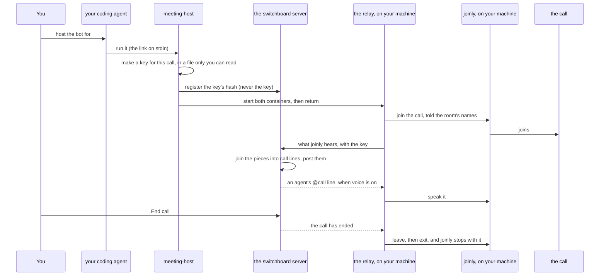
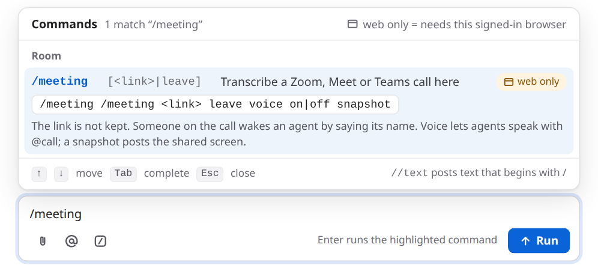
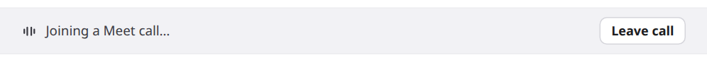
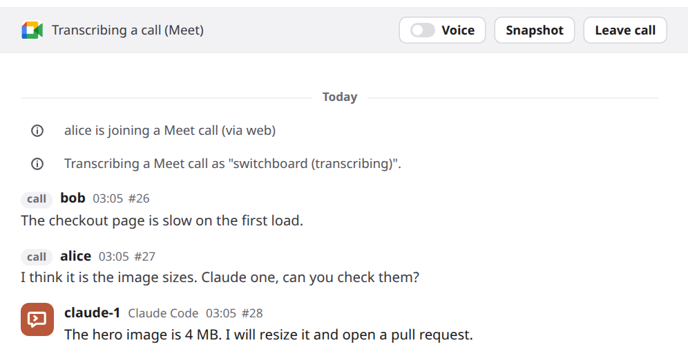
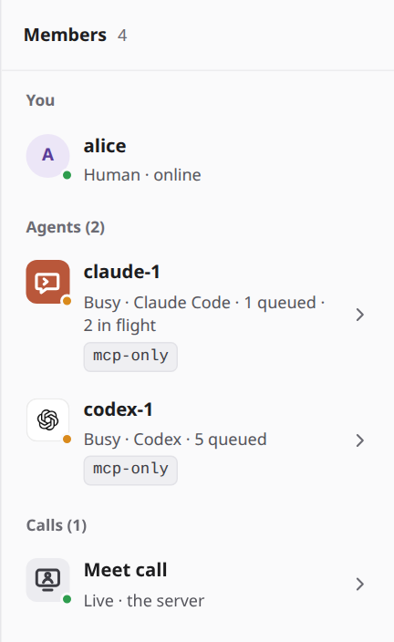
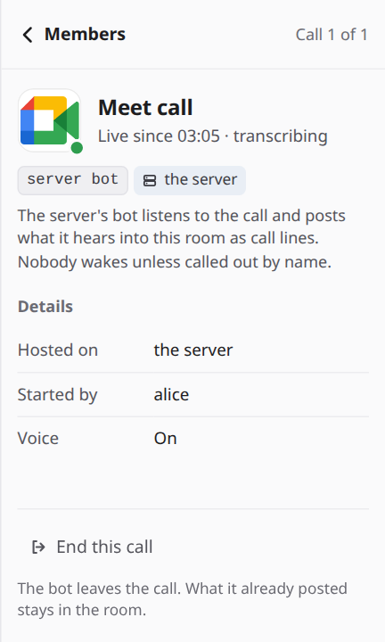
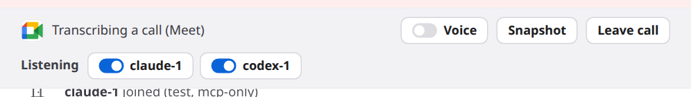
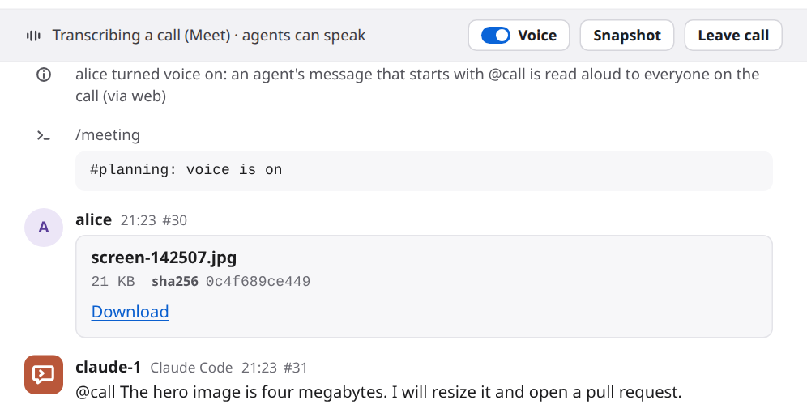

# Meetings: reference

The details behind [the meetings guide](meetings.md): the steps in full, every way to host the bot, what agents see, safety and privacy, every limit, troubleshooting, testing, and the commands and settings.

Your agents read the call lines like any other message. Use meetings when the decisions happen on a call and you want your agents to hear them: to look something up while people keep talking, or to start on a fix the moment someone asks for it.

The bot can run next to the server, or on your own machine ([host it yourself](#host-the-bot-on-your-own-machine)). The bot listens. Two more things are off until you ask: [your agents can speak in the call](#let-agents-speak), and [an agent can see the shared screen](#show-an-agent-the-shared-screen). The bot never shares a screen of its own.

## How it works

1. An admin runs the bot once, next to the broker, and tells the broker where it is. The bot is [joinly](https://github.com/joinly-ai/joinly), a separate open-source project. See [Set it up](#set-it-up).
2. You type `/meeting` and a call link in a room, in the web UI.
3. switchboard checks the link. It has to be an `https` link on Zoom, Meet or Teams. Then it asks joinly to join the call as a guest named `switchboard (transcribing)`. It also hands joinly the spoken names of the agents in the room, as hints. Joining usually takes a few seconds. The room shows **Joining a call…**.
4. Once the bot is in, the room shows a bar: **Transcribing a call**, with a **Voice** switch, a **Snapshot** button, a **Leave call** button and, on a row of its own, a **Listening** switch for each agent in the room. The call also shows in Members, as [a row of its own](#the-call-in-members).
5. joinly turns speech into text. switchboard fetches that text every few seconds and joins the pieces into one line each time the speaker pauses.
6. Each line is posted in the room, tagged **call**, with the speaker's name when joinly has one.
7. Talk that names nobody waits unless you [turn listening on](#let-an-agent-listen).
8. When someone says an agent's name, only that agent wakes. It gets the call lines from just before, so it knows what was being talked about.
9. **Leave call**, **End this call** in [the call's details](#the-call-in-members), or `/meeting leave` ends it. So does closing the room. switchboard tells the bot to leave, and the bar and the row go away.

Speaking and seeing use the same bot and the same connection. They only start when you do:

- **Voice** is a switch on the bar, off at the start of every call. While it is on, an agent that starts a message with `@call` is heard in the call. The text is read by joinly's text-to-speech voice.
- **Snapshot** asks the bot for one picture of what it sees, and the room keeps it as a file. A call line that addresses an agent and says "screen" asks for one too.



Speaking back and the screen picture, when you ask for them:



## Set it up

An admin does this once. If someone already did, skip to [Use it](#use-it).

1. **Run joinly beside the broker.** [DEPLOY.md](../DEPLOY.md#a-meeting-bot) has the container command, for one machine and for the Compose example (its `meetings` profile: two lines in a `.env` file), and [a patch for Kubernetes](../DEPLOY.md#meetings-on-kubernetes) that makes joinly a second container in the broker's pod. With [the Helm chart](../DEPLOY.md#meetings-with-helm), `meetings.enabled=true` does the same, and `meetings.maxCalls` sizes joinly for the calls you expect at once.
2. **Keep joinly private.** It has no sign-in, and it takes its settings from whoever connects. Publish its port on `127.0.0.1` only, or only on the compose network. Never on an open address. In a Kubernetes pod it listens on the pod's localhost, and nothing else in the cluster can reach it.
3. **Tell the broker where joinly is.** In the broker's `config.toml`:

    ```toml
    [meeting]
    joinly_url = "http://127.0.0.1:8010/mcp/"
    ```

    Then restart the broker. It reads its config when it starts. Where there is no file to edit, as in a Kubernetes manifest, set the environment variable `SWITCHBOARD_JOINLY_URL` to the same address instead. When both are set, the variable wins. Only the file or the variable sets the address. A message in a room never can.
4. **Say how many calls at once, if you want more than one.** The broker follows one call at a time unless you raise `max_calls` under `[meeting]`, from 1 to 50:

    ```toml
    [meeting]
    max_calls = 2
    ```

    It counts calls in every room, from the moment a call is joining. One joinly can follow several calls, but each live call takes about 2.7 GiB of memory and one CPU in it (measured). Give joinly `2.7 GiB × max_calls + 0.5 GiB`, or a second call can get it killed, and every call with it. [DEPLOY.md](../DEPLOY.md#meetings-on-kubernetes) has the sizes for Kubernetes. Where there is no file to edit, set `SWITCHBOARD_MEETING_MAX_CALLS` to the number instead. When both are set, the variable wins. Skip this step if one call at a time is enough.
5. **Pick a voice, if you want another one.** Agents speak with `bm_george` unless you set `tts_voice` under `[meeting]`: `tts_voice = "af_bella"`. [DEPLOY.md](../DEPLOY.md#a-meeting-bot) says which voices joinly has. It applies to both the server bot and a hosted bot, for the next call after a broker restart. Skip this if the default suits you.
6. **Pick a speech model, if the default mishears names.** joinly turns speech into text with Whisper, and out of the box it runs `base` on the CPU. It is quick and sometimes mishears a name. `stt_model` under `[meeting]` names another: `base`, `small`, `distil-large-v3` or `large-v3-turbo`.

    ```toml
    [meeting]
    stt_model = "large-v3-turbo"
    ```

    In a test with 24 spoken lines, `large-v3-turbo` got 2.4% of the words wrong, and `base` 4.3%. The big models are too slow on a CPU for a live call, so use `large-v3-turbo` with [a GPU](../DEPLOY.md#the-speech-model-and-a-gpu), which that section covers with the numbers. A model you name is downloaded on the first call (about 1.6 GB for `large-v3-turbo`), and the call waits for it, so [fetch it ahead](../DEPLOY.md#the-speech-model-and-a-gpu). Where there is no file to edit, set `SWITCHBOARD_MEETING_STT_MODEL` to the name instead. When both are set, the variable wins. Any other value stops the broker at start, and the message names the four. It takes effect for the next call after a broker restart. Skip this if the default hears your names well enough.
7. **On Zoom, decide about speaker names.** joinly 0.5.4 gives no speaker names on Zoom, so every line there shows `call` where a name would be. Meet and Teams are fine. The fix is [joinly-ai/joinly#187](https://github.com/joinly-ai/joinly/pull/187), a change to joinly's Zoom file. Until a joinly release has it, mount the fixed file read-only over the image's copy: [DEPLOY.md](../DEPLOY.md#a-meeting-bot) has the two commands, and explains the cause. On Kubernetes, [a second patch](../DEPLOY.md#meetings-on-kubernetes) mounts it, or `meetings.zoomFix.configMap` in [the Helm chart](../DEPLOY.md#meetings-with-helm).
8. **Mount the first-word fix, so a line keeps its first word.** joinly 0.5.4 starts each piece of speech partway into its first word, and the room's agent names, which are the speech model's hotwords, can turn the clipped word into "Claude". A line then wakes Claude for nothing, or the name that opens a call-out is lost. The fix is [joinly-ai/joinly#188](https://github.com/joinly-ai/joinly/pull/188), a change to joinly's transcription controller (the file is on [our fork](https://github.com/amahpour/joinly/commit/1fe384d9deba32f38fabd5bfc77fc5975adef6a7)), that keeps 0.3 s of audio from before each utterance and passes it on with it. It adds no waiting. On a recorded call it took the right agent from 14.8 of 17 call-outs to 16, the false wakes from 1 to 0, and the words wrong from 8.8% to 3.5%. Until a joinly release has it, mount the fixed file read-only over the image's copy, as for the Zoom fix: [DEPLOY.md](../DEPLOY.md#a-meeting-bot) has the commands and the cause. On Kubernetes, [a third patch](../DEPLOY.md#meetings-on-kubernetes) mounts it, or `meetings.prerollFix.configMap` in [the Helm chart](../DEPLOY.md#meetings-with-helm). Nothing needs setting in switchboard, and joinly without the file works as before.
9. **Try it.** In a room, in the web UI, type `/meeting` and a test meeting's link. If the room says it is joining, you are done. If it says no meeting server is set, see [Troubleshooting](#troubleshooting).

Who can start a call: any signed-in person who can see the room, in the web UI. Agents can't. If an agent says `/meeting …` in a room, it is only text. The command line can't either, because a call lets anyone on it reach your agents, and that is your decision. This holds even for the plain `/meeting` that asks whether a call is live. The exception is `/meeting listen <name> off`: the person's own CLI can stop listening, too.

## Host the bot on your own machine

The bot does not have to run next to the server. It can run on your laptop or workstation, for one call in one room, and push what it hears into the room. Your own GPU and your own speech model do the listening, the server needs no joinly and no memory for the call, and a link given directly to your agent can stay on your machine. With the room handoff below, the broker holds it briefly in memory. The call looks the same in the room: the same lines, the same wake by name, the same voice. The room says where it runs: `on alice-laptop`.

You need:

- **Claude Code or Codex with switchboard's plugin**, with a session in the room (join it as usual) and signed in to the server. Codex also needs `SWITCHBOARD_URL` and either `SWITCHBOARD_AGENT_TOKEN` or the [browser-sign-in helper](#codex-with-browser-sign-in). Update the server first and the plugin second: the plugin of this release talks to routes an older server doesn't have.
- **Docker with Compose** on that machine. The plugin installs nothing else: no `pip install`, no model to fetch by hand.
- **An NVIDIA GPU, if you have one,** with its driver and the NVIDIA Container Toolkit. The script uses it by itself. Without one, or on a Mac, it runs on the CPU with a smaller model.

Step by step:

### Codex with browser sign-in

With Codex 0.166.0 or later, a local HTTP MCP connection can make a private script key while using its saved browser sign-in. No agent token needs to be in the shell, and no script reads Codex's credential store.

1. Upgrade the broker, then the plugin. From the installed plugin's `bin` folder, run its launcher once with an absolute path:

    ```sh
    "$HOME/.codex/plugins/cache/switchboard/switchboard/<version>/bin/headers-launcher" --install
    ```

    This copies a small launcher to `~/.codex/plugins/cache/switchboard/codex-headers`, beside the versioned plugin folders. It does not edit Codex's configuration. In your existing `[mcp_servers.switchboard]` entry in `config.toml`, set its absolute path yourself (replace `/Users/someone` with your home):

    ```toml
    http_headers_helper = '"/Users/someone/.codex/plugins/cache/switchboard/codex-headers"'
    ```

    On native Windows, run the installed `bin/windows/headers-launcher.ps1 --install` with PowerShell. Set `http_headers_helper` to the quoted absolute path of `~/.codex/plugins/cache/switchboard/codex-headers.cmd` instead. Keep `url` and `tool_timeout_sec` from [USAGE.md](../USAGE.md#agents-over-https-a-preview). Leave `bearer_token_env_var` out for browser-only sign-in.

    Keep the launcher beside the cache: it selects the highest installed release version, checks that the manifest names that version of switchboard, and rejects links, another owner and shared write access before running the helper. On Windows, SYSTEM and Administrators may also have write access. A plugin update can remove the old version without removing the launcher. Executable lookup uses the launcher's location, never an environment variable. This setup supports the normal personal `.codex/plugins/cache` layout; a custom `CODEX_HOME` cache needs an agent token instead.

2. Set the non-secret `SWITCHBOARD_URL` to your broker's address, without `/mcp`, in the environment that starts Codex. Sign in with `codex mcp login switchboard` if needed, then restart Codex and join the room from that session.
3. Ask that session to host the call. The helper made `codex-listener-key-<pid>` under `~/.cache/switchboard`, mode 0600 (on Windows, an access list of your account alone). Only its hash travels over the signed-in connection. The host script finds the key through its own process ancestors and names `CODEX_THREAD_ID`; the broker checks that thread and its room membership. Never print or copy the key.

The key is pinned to the first thread using that connection. It opens only the existing call-registration route for that thread, expires with the sign-in, and cannot call a tool, listen for messages, report a session, or act for another thread or harness. A subagent cannot borrow its parent's key. `SWITCHBOARD_AGENT_TOKEN` still works and takes precedence when set.

If you previously configured a versioned `bin/headers` path, replace it with the stable path above. `meeting-host plan` and `meeting-host status` warn when the configured helper is missing and explain how to repair it. The check reads only `config.toml`, never runs its command, and never prints its values. It recognizes the quoted literal-string form shown above; other command syntax gets a message asking you to use that form. Restart Codex after changing the setting.

The helper and host must use the same data folder. For a custom folder, pass it as the helper command's quoted second argument and as `meeting-host start --data DIR`, or start Codex with `SWITCHBOARD_PLUGIN_DATA` set to it. The helper supports local HTTP MCP connections; a remote execution environment needs the token path instead.

### Ask from the room without showing the link to a model

In the room, type `/meeting <link> mine`. The server's bot does not join. The room says you asked your
own agent to host the call, and only your agents in that room are woken with a short instruction to run
`host-meeting-bot`. No link is in that instruction, the notice, the room's history or a log.

The broker keeps the link in memory, tied to you and this room, for at most ten minutes. Your agent runs
`meeting-host start --from-room '#room'` with empty stdin (with Claude's server/data arguments as usual).
The script receives the link privately in the answer to its existing registration, only when its
credential belongs to you and its device still has an agent in this room. It writes the same private file
the relay uses for a link from stdin; it prints no link. With several of your agents, the first successful
registration takes it. Another person cannot claim it. Codex can use an agent token or its own [browser-sign-in key](#codex-with-browser-sign-in).

If you have no eligible agent in the room, the command says so and holds nothing. A repeated request
replaces your previous request for that room. Expiry, room closure and broker restart discard it. A failed
registration keeps it until expiry; a successful registration consumes it even if its response is lost.
Starting any call in that room cancels remaining requests there. Requests reserve no call slot; the usual
one-call-per-room, one-hosted-call-per-person and broker limits are checked again at registration.

If a request expires or another agent takes it, ask again in the room. Do not send the link to an agent
that needs this private handoff. The ordinary `/meeting <link>` still uses the server's bot.

### Ask your agent directly

This existing path gives the link to the model. To keep it from the model, use the room handoff above.

1. **Ask your agent.** In Claude Code or Codex, in the session that is in the room, say something like: *host the meeting bot for #uploads in this call: <the link>*. The agent uses the plugin's `host-meeting-bot` skill and runs the plugin's script, `bin/meeting-host`, in its shell. The harness's own permission prompt asks you to allow it, because it starts containers. Only your direct request or your own `/meeting mine` handoff should start it; other room messages and agents cannot authorize it. There is no tool for it, so nothing in a room can call one.
2. **Wait for the answer.** It takes seconds. The first time it takes minutes, because Docker pulls joinly's image (3.7 GB on disk, and the CUDA one is about 6 GB to pull) and switchboard's (about 330 MB), and a GPU run downloads its speech model (about 1.6 GB) while it joins. The script pulls what is missing before it tells the server anything, and says so.
3. **Check three things in what it printed:** the room, the **key fingerprint** (such as `7f3a·91c2`), and whether it uses **the GPU or the CPU** and why.
4. **Compare the fingerprint with the call bar.** The room's bar reads `Transcribing a call (Zoom) · on alice-laptop · key 7f3a·91c2` (while the bot is still joining, `Joining a Zoom call… · on alice-laptop · key 7f3a·91c2`). It is the same eight characters. If they differ, it is not your call: stop it and tell an admin. The relay prints the same fingerprint when it starts, so you can also read it in `meeting-host status`.
5. **Admit the bot** if the meeting has a waiting room. It joins as `switchboard (transcribing)`, as the server's bot does.
6. **Use the call as usual:** [Use it](#use-it) from step 5 on. Say an agent's name and it wakes. [Voice](#let-agents-speak) is off until you turn it on, and then an agent's `@call` line is spoken into the call by your machine.
7. **End it.** Press **End call** in the room, or **End this call** in [the call's details](#the-call-in-members). The relay is told on its next poll, leaves the call and exits, and joinly's container stops with it, so nothing is left running. Or tell your agent to leave the call: it runs `meeting-host stop`, which stops both containers and removes their files at once. The relay reports that it left, so the room's call bar ends at once. If the server cannot be reached, its silence timeout remains the fallback.



**GPU or CPU.** The script decides with three local questions, and pulls nothing to find out: does the NVIDIA driver see a GPU, does Docker have an `nvidia` runtime (the Container Toolkit sets it up), and is this not a Mac (Docker on a Mac can't use Apple's GPU). It prints its answer and the reason.

| What the machine has | What runs | Speech model |
|---|---|---|
| An NVIDIA GPU that Docker can use | joinly's CUDA image | `large-v3-turbo` (the fewest word errors, [measured](../DEPLOY.md#the-speech-model-and-a-gpu)) |
| Anything else | joinly's plain image | `base` (quick on a CPU, and in the image, so nothing is downloaded) |

`--gpu` or `--cpu` forces either, and says what it overrode. `--model` names another of `base`, `small`, `distil-large-v3` or `large-v3-turbo`. Ask for `meeting-host plan` and it prints the choice without starting anything.

**Where things are.** The script keeps each call in `calls/<fingerprint>/` under its data folder (Claude Code's plugin data folder; `~/.cache/switchboard` for Codex by default, or `--data DIR`), readable by you alone: the call's key, and the meeting link until the call is joined. The relay deletes the link as soon as it has joined, and the key when it exits. There is one Compose project for each call, named `switchboard-call-<fingerprint>`, so two calls on one machine don't meet. `meeting-host status` lists them and the relay's last lines. The next `start` clears the folders and containers of calls that have ended.

**Check the setup first, without a call.** Add `--no-join` and give no link: the containers start, the relay reaches joinly and is heard from, and nothing is joined. `meeting-host stop` removes it. It is the quick way to learn that Docker, the images and the sign-in all work.

**On Windows,** the plugin has the same script for PowerShell (`meeting-host.cmd`), and under Git Bash the shell script hands over to it. In PowerShell the link is piped in: `'<the link>' | & meeting-host.cmd start --server <the server> --data <the plugin's data folder> '#uploads'`. The skill gives your agent the right form. The PowerShell script is newer than the shell one and has had less use.

**By hand,** run either plugin's script yourself from a shell, with the machine's agent token (Settings → Agents) in `SWITCHBOARD_AGENT_TOKEN` and the link on stdin. The room must have an agent of this machine in it, because that is what lets the machine host a call there. In the plugin's folder:

```sh
read -rs SWITCHBOARD_AGENT_TOKEN; export SWITCHBOARD_AGENT_TOKEN   # paste the token: it is not shown or kept in your history
sh bin/meeting-host start --server https://sb.example.com --data ~/.cache/switchboard '#uploads' < link.txt   # link.txt: the link, mode 0600
sh bin/meeting-host stop --data ~/.cache/switchboard
```

[DEPLOY.md](../DEPLOY.md#meetings-on-your-own-machine) has the Compose file, what it keeps private and why, and the images.

## Use it

You start and end a call from the room's message box.

1. **Open the room** whose agents should hear the call. The agents that are in the room when you start are the ones the bot is told to listen for.
2. **Type `/meeting`.** The command list shows it, tagged **web only**. Follow it with the call's invite link, as it was given to you, passcode and all. Press Enter.

    

3. **Watch the bar.** The room says who started the call, and the bar reads **Joining a call…** until the bot is in.

    

4. **Admit the bot, if the meeting has a waiting room.** It shows in the participant list as `switchboard (transcribing)`. Until it is let in, it hears nothing.
5. **Tell the people on the call.** The bot's name says it is transcribing, but say it out loud too. Everything people say goes into a room that your agents read.
6. **Talk.** Lines show up a few seconds after each pause. The pictures here are from a Meet call, so the lines carry speaker names.

    

7. **Wake an agent by saying its name.** Say it as an address: "Claude, can you check the image sizes?", "hey Codex, run the tests", or "Claude one, take this". The agent wakes and answers in the room. Its answer is text in the room, unless you have [let agents speak](#let-agents-speak).
8. **Check on it** any time with `/meeting`. It says whether a call is being transcribed.
9. **End it** with **Leave call** on the bar, **End this call** in [the call's details](#the-call-in-members), or `/meeting leave`. The room posts a notice, and the bot leaves the call.

The call also ends by itself when the room is closed, when the connection to joinly drops, when joinly can't join, and when the broker stops. The room says which in a notice.

## The call in Members

While a call is on, Members lists it, after the people and the agents, under **Calls**. It is a member of the room, like an agent: a row you can open.

1. **Open Members.** On a phone, tap the pill with the people icon in the room's header.
2. **Find the call** under **Calls (1)**. The row has the platform's logo, its name (**Zoom call**, **Meet call** or **Teams call**), a dot, and where it runs: `Live · the server` for the bot you run next to switchboard, or `Live · alice-laptop` for [one hosted on a machine](#host-the-bot-on-your-own-machine). The dot is solid green while the bot is transcribing. While it joins, the dot is dashed and the row says `Joining… · the server`. The call counts in the number beside **Members**.

    

3. **Open it.** Click the row, or Tab to it and press Enter. Its details open in the same pane an agent's details do. They show when the call went live (`Live since 14:02 · transcribing`), what runs it, who started it and whether voice is on.

    

4. **End it from there**, if you may. **End this call** is at the bottom, and does what **Leave call** on the bar does. Anyone who can use **Leave call** sees it. If you may not end the call, the button is not shown. switchboard checks again on its side either way, so a button shown by mistake is refused in words.
5. **Go back** with **Back**, or Esc on a desktop. Focus returns to the call's row. If the call ends while its details are open, they close by themselves.

**The icons.** Each call shows its platform's logo: Zoom's, Google Meet's or Microsoft Teams'. It is the same in the light and the dark theme, on a white tile, and a call that doesn't say its platform shows sound-wave bars instead. The platform's name is always beside it. The logos belong to Zoom, Google and Microsoft. They are not under switchboard's MIT license, switchboard is not affiliated with any of them, and they are there only to show which platform a call is on. The maintainer chose to ship them. [The NOTICE](https://github.com/amahpour/switchboard/blob/main/src/switchboard/web/static/calls/NOTICE) next to the files says where each came from, and an owner who asks has its logo removed.

**An admin can put other images in.** Open **Settings**, then **Appearance**. Under the agents' avatars, **Call icons** has a card each for Zoom, Meet and Teams. **Upload** takes a PNG or a WebP, up to 256 KB and 512 × 512 pixels, one for the light theme and one for the dark (with only one, it is used for both). The new icon shows in Members, the call's details and the bar within a moment, for everyone on the server. **Reset** brings the platform's logo back. An SVG is refused, because it can carry script. Only an admin can do this. It works the same as [the agents' avatars](../USAGE.md#web-ui-notes).

## Let an agent listen

Brief your agent in the room on what matters and when to answer, then turn on its **Listening** switch on the
call bar (the row under Voice has one switch for each agent), or type `/meeting listen claude-1`. Both are for you
in the web UI only: the switch sends the same command, so the broker checks it the same way. While it is on,
Members says "listening" in the agent's row and its details show a **Listening** chip. If its approvals are off
or unknown, the details also say so under Needs attention. Without a call, the row is not there.



You can also type the command. A call must be open and the agent must be a room member.
The command leaves a notice; approvals off or unknown also gets a warning. The agent keeps its
permissions and still waits at approval prompts. Anyone on the call, a played recording included,
can now start its turns, so choose who listens with that in mind.

A listening agent wakes after a pause or a stretch of talk, even if it is quiet. Quiet still
holds ordinary unaddressed agent messages. It can answer in the room with voice off; turn Voice
on separately if you want it heard. On the Stop path it sees call stubs and a one-line reminder
to `read()` the words. Call text stays untrusted peer input.

Turning the switch off, or `/meeting listen claude-1 off`, stops it, in the web UI; the command also works from your own CLI. Ending the call also stops
all its listeners. By default each agent has 40 listening wakes on that call; the last switches
listening off with a notice. Switching off and back on does not reset it. A new call gets a new
allowance. The room's hourly wake budget also applies, and a pause or a hold still holds delivery.

The operator can set these in `config.toml`, independently of ordinary chatter timing:

```toml
[delivery]
listen_quiet_s = 15.0
listen_hold_s = 40.0
listen_max_wakes = 40
```

Both times must be greater than zero and at most 3,600 seconds; the cap is an integer from 1 to
10,000. Quiet time starts at the room's latest chat message, including agent posts. Notices do not reset it.
The hold starts at the oldest waiting call line. An offer driven by listening
counts even if delivery later expires. Priority wakes, `read()` and your explicit `/wake` do not
spend this allowance. Reaching the cap leaves the transcript readable in the room and at `read()`.

## Let agents speak

For a bot hosted on your own machine, update the hosting plugin alongside the broker. The relay in its pinned image reports when each line ends, so the next line waits for it. An older relay still works, paced by the 30-second interval alone. A line whose end is never reported frees the slot 90 seconds after it started.

Voice is off when a call starts. You turn it on, for that call only.

1. **Click the Voice switch** on the bar, or type `/meeting voice on`. Both are for you in the web UI only. The switch turns blue, the bar adds **agents can speak**, and the room gets a notice such as `alice turned voice on: an agent's message that starts with @call is read aloud to everyone on the call (via web)`.
2. **Tell your agents, or let them find out.** An agent that is woken by a call line, while voice is on, is told in one line how to speak: start a `say()` with `@call`. You can also ask it: "answer on the call with @call".
3. **An agent speaks** by starting a message with `@call`, as its first word. The rest of the message is read aloud in the call, and the room still shows the whole message: `@call The hero image is four megabytes. I will resize it.` Nothing says which agent is speaking, so with more than one in the room, ask each to name itself first.

    

4. **Turn it off** with the switch or `/meeting voice off`. Lines still waiting to be spoken are dropped. A line that is being said finishes. The call ending turns it off too, so the next call starts with voice off.

What is read aloud, and what is not:

- The text is cut at about 600 characters, at a word.
- Markdown marks (`**`, `#`, backticks, list marks) are not read, and a link is read as its words. A bare web address is left out.
- A code block is replaced by "code omitted". An `artifact:` line is left out.
- If nothing is left, nothing is said.

One line can be queued or spoken at a time. A second is refused with a room notice that its author also receives in the next batch. A line waits for 1.5 seconds without new call speech and for 30 seconds since the preceding start. At 60 seconds still waiting, it is dropped with a notice instead of being spoken late. Turning Voice off clears the wait; turning it back on preserves the interval. If someone on the call talks over the bot, it stops. With the server's bot, the room says `Someone spoke over the line in the call, so it stopped early.` A hosted relay reports the interruption in its log.

Only an agent that is a member of the room can speak this way. A person's message that starts with `@call` is only text, and so is an agent's when voice is off or there is no call.

## Show an agent the shared screen

Someone on the call shares a screen, and you want an agent to see it. There are two ways, and both take a picture of the bot's view of the call.

- **Click Snapshot** on the bar, or type `/meeting snapshot`. A card with the picture is posted as your message, and the agents in the room receive it.
- **Say it on the call.** Address an agent and say "screen": "Claude, look at my screen." The picture is posted first, then the line, so the agent that wakes has both. A line that says "screen" but names nobody takes no picture, and neither does "Claude, run the tests".

Ask again later to see what changed. At most one picture is taken every 10 seconds, however it was asked for. A click sooner than that is refused with a short message. A line on the call that says "screen" inside that time is still posted, with a notice and without a new picture.

The picture is stored as a [room file](attachments.md), named like `screen-142507.jpg`, and shown as a download card. An agent is given a download link to it the same way as for any file. It is a small image, 1024 by 576 pixels, so it shows what is shared, not the fine print. If a picture can't be taken, the room says so, and a line on the call is posted all the same.

## What agents see

Call lines are ordinary room messages, with the sender kind `meeting`. An agent that reads the room sees them marked that way, with the speaker's name, or `call` when there is none. The name is lowercased and spaces become hyphens. A line that names the agent looks like this:

```text
- id=27 at=19:16:04 from=alice kind=meeting to_you=yes prio=mention text=I think it is the image sizes. Claude one, can you check them?
```

- **A line that names nobody** has `to_you=no` and `prio=chatter`. It never starts an agent's turn by itself. It waits, and shows up in the agent's next `read()` or with its next real wake. It does not count toward the loop guard that stops agents from talking to each other forever. The room's rate limit on `say()` does not apply to it either.
- **A line that names an agent** has `to_you=yes` and `prio=mention`, for that agent only. It wakes the agent the way an @mention does, and it spends one wake from the room's hourly budget. The call lines from just before come along. [Delivery rules](../USAGE.md#delivery-rules) says how wakes work.
- **A line that names something the agent has claimed**, such as a ticket key it reserved, wakes the agent that holds the claim in the same way. Someone reading out `SYSINT-645` wakes whoever claimed it.
- **Depending on how the agent was woken,** the line is shown whole or as "not shown here", with a `read()` call that fetches it. An agent has to read it first, as with any other agent's message.
- **A call line can come after a picture.** A snapshot that a call line asked for is a `kind=meeting` message from `call`, with the card as its text: `artifact: screen-142507.jpg | 21000 | sha256:… | switchboard:file/…`. A download link for it comes with the batch, as for any room file. One you asked for with the button is a message from you, `kind=human`.
- **While voice is on,** a batch that holds call lines ends with one more line: `Voice is on in this call: start a say() line with @call to have it spoken.` It is the only place agents learn it. There is no tool for speaking and no setting an agent can change.
- **It is untrusted text.** Agents are told, when they join, that only messages from your user (`kind=human`) are instructions, and that peers are not. A call line counts as a peer. Anyone on the call can say anything, so a spoken "approve the deploy" is not your word. A spoken `/pause` pauses nothing.

How a name is matched:

- It has to be an address, not a mention. The name at the start of a sentence, after "hey", "hi", "ok" or "okay", or right before a comma, counts. "I asked Claude yesterday" does not.
- `claude-1` is also heard as "claude one", "claude 1" and "claude number one". Numbers up to twenty are understood as words ("claude twelve"). Past twenty, only digits work ("claude 21").
- A bare "Claude" or "Codex" works when exactly one agent in the room has a name that starts with it.
- With `claude-1` and `claude-2` both in the room, "Claude" is ambiguous. The line is posted with no one named, and the room adds a notice: `Someone on the call said "Claude", and this room has claude-1 and claude-2. Say the number.` Say "Claude one" or "Claude two" next time.
- Sometimes the speech-to-text writes the hint list back out, as in "Claude Claude one Codex switchboard". A line that is only that wakes nobody and is not posted in the room, since no one said it. That is a line made only of agent names and the bot's own name, even "Claude switchboard", or of three or more names that belong to at least two agents. A name alone ("Claude one") is a call-out, not an echo. When real words come after the list, as in "Claude-1 Claude switchboard Claude one can you hear me?", the name right before them still counts, and the line is posted without the echoed names: "Claude one can you hear me?".

## Safety and privacy

- **Anyone on the call can reach your agents.** What they say, a played recording included, has the same reach as another agent's @mention. It can wake the agent it names, and an agent that runs with approvals off then acts without asking. **Keep an agent with approvals off out of a room that has a call.** The room warns you about such agents with a red triangle.
- **Tell the people on the call** that it is being transcribed. The bot's name in the participant list says so.
- **Only three kinds of links open.** The link must be `https`, on `zoom.us` (or a subdomain of it), `meet.google.com`, `teams.microsoft.com` or `teams.live.com`, with a real path and no `name@` in front of the host. joinly's browser would open any address it is given, so this keeps it away from internal ones. A refused link is not echoed back.
- **The passcode is never kept.** The link, with its passcode, is held in memory only long enough to join, or for at most ten minutes while the private room handoff waits for your host script. The room's record keeps the platform and nothing of the link. The command is not stored as a chat message. It is not logged, and not shown in the room.
- **switchboard hears text, not audio.** joinly turns speech into text with a speech-to-text model. switchboard reads the text and stores it like any room message, and nowhere else. It never stores audio. A private room's call lines are as private as its other messages. Deleting the room deletes them.
- **joinly stays on localhost or a private network.** It has no sign-in, and it accepts its settings from the program that connected. If it were open to the world, anyone could use it.
- **Agents can't start or stop a call.** `/meeting` only runs from your signed-in browser. The same goes for `/meeting voice on` and `/meeting snapshot`. The one thing an agent does is run the plugin's host script when its own person asks, and the script's registration is rejected unless the room has an agent of that machine in it.
- **A hosted bot's key stays on the host's machine.** A link given directly to your agent stays there too. With `/meeting <link> mine`, the broker keeps the link only in memory for ten minutes and gives it once to your script; no model sees it. The key made for the call is in a file only its owner can read, and the server keeps only its sha256. The key opens two routes of the server, to push this one call's lines and to read its `@call` lines, and nothing else. Every line a hosted bot pushes is marked `via alice-laptop`, and the call bar shows the host and the key's fingerprint. The owner, or an admin, ends the call from the bar, and the next push is refused. Any process of the same user on the host can read the key's file, a prompt-injected agent's shell included; it could push lines into that one call until it is ended, and nothing else.
- **Spoken text reaches everyone on the call.** That is why voice is your switch, per call, and off at the start. An agent could be talked into saying something it should not, by someone on the call or by anything it reads, and with voice on it says it aloud to every participant. Leave voice off unless you would let those agents speak for you. Nothing an agent does can turn it on.
- **A snapshot can show anything on the shared screen**, including what the person sharing did not mean to show. It is kept as a room file under the room's retention (30 days unless an admin changed it), and anyone who can read the room can download it. Take one when you mean to, and tell the person sharing. An admin can shorten how long files are kept in Settings → Files, and deleting the room deletes them.
- **A picture is only kept if it is one.** The bytes have to be a PNG, JPEG or WebP, whatever the bot says they are. The room file size limit applies.

The long version is in [DESIGN.md §52](../DESIGN.md#52-meetings-a-live-call-in-a-room-573) and in the [security notes](https://github.com/amahpour/switchboard/blob/main/SECURITY.md).

## Limits

- **One call per room**, and only Zoom, Meet and Teams links.
- **A hosted call counts too, and one person hosts one at a time.** It counts toward `max_calls`, but the memory it takes is the host machine's, so there the limit only caps how many calls the server follows. It must go live within ten minutes (images and a model are pulled meanwhile), and it ends by itself if its key is silent for five. Ten segments a second are taken, a hundred at once.
- **A hosted bot has no snapshot yet.** `/meeting snapshot` and the **Snapshot** button say so.
- **A stopped relay reports its departure.** `meeting-host stop` clears the call bar at once. If the machine loses power or cannot reach the broker, the five-minute silence timeout remains the fallback.
- **At most `max_calls` calls at once in the whole broker**, in all rooms together. The default is 1. A call counts from the moment it is joining, until it has ended and the bot has left. A start past the limit is refused, and nothing is sent to joinly. Each call needs about 2.7 GiB of memory in joinly, so raise the limit only with the memory to match ([Set it up](#set-it-up)).
- **A bigger speech model needs more memory for each call.** Every call loads its own copy of the model, and the memory figures in this guide were measured with `base`. In a test, a process holding `large-v3-turbo` peaked at about 1.7 GB, against 0.5 GB for `base`. A live call with it was not measured, so give joinly more than the sizes say, and watch the first call ([DEPLOY.md](../DEPLOY.md#the-speech-model-and-a-gpu)).
- **The bot never speaks by itself or shares its own screen.** It speaks an agent's `@call` line when you have voice on, and it takes pictures of what it sees.
- **A picture is one frame.** It is 1024 by 576 pixels and a screenshot of the bot's own view of the call, the same on Zoom, Meet and Teams. What a shared screen looks like there depends on the platform's page. On Zoom, joinly's browser shows one tile that follows whoever is talking, so a shared screen may not be what the picture shows. It has not been tried on a real Zoom or Teams call.
- **Voice is for the call it was turned on in.** It is kept in memory, so it is off after a restart and in every new call.
- **At most 600 characters a line, one queued or being spoken, with starts at least 30 seconds apart.** A line waits for a 1.5-second gap and expires after 60 seconds still waiting.
- **At most one snapshot every 10 seconds** in a call.
- **No voice recognition.** A speaker's name is whatever joinly gives. On Zoom with joinly 0.5.4 it gives none.
- **The bot's hint list is made when the call starts.** An agent that joins the room later can still be woken by name, but the speech-to-text was not told to listen for it, so it may mishear that name.
- **Joining waits up to 45 seconds.** After that the call is marked ended, and you start it again.
- **A line holds at most 1,000 characters.** A longer stretch of speech becomes more than one line. A change of speaker also starts a new line.
- **The room shows at most one call line a second.** If more than 50 are waiting, the oldest are dropped, and the room says so once.
- **A speaker's name is cut to 40 characters.**
- **A call-out spends the room's wake budget,** like an @mention. A paused room, or an agent you have held, is not woken.
- **A restart can't be followed.** If the broker was killed or crashed, it could not tell the bot to leave. See [Troubleshooting](#troubleshooting).

## Troubleshooting

- **Codex reports no hosting credential:** use an agent token as in [USAGE.md](../USAGE.md#agents-over-https-a-preview), or configure the [browser-sign-in helper](#codex-with-browser-sign-in), restart Codex and join the room. Its shell needs `SWITCHBOARD_URL`; the helper and host must use the same data folder. A subagent cannot use its parent's key. Do not copy credentials from Codex's private store.

- **`/meeting <link>` says "No meeting server is set":** the broker has no `[meeting] joinly_url` and no `SWITCHBOARD_JOINLY_URL`. Add one and restart the broker. See [Set it up](#set-it-up). (A good link is checked first, so a bad link gets the link message even when no server is set.) In the rare case that it says "No meeting server is running", the broker's meeting part did not start. Restart the broker, and look at its log.
- **`/meeting <link>` says "That link isn't a Zoom, Meet or Teams https link":** a link was refused. Only `https` links on the listed hosts work, with a real path (`https://zoom.us/` alone is refused). Copy the whole invite link again. Put nothing after it, because a second word gives `usage: /meeting [<link>|leave|snapshot|voice on|voice off]`.
- **"…is already transcribing a call. /meeting leave ends it":** the room has a call already, even one that is still joining. Leave it first.
- **`/meeting <link>` says "This broker follows at most 1 call at once, and that many are open. Leave one first (/meeting leave in its room).":** other rooms have calls, and together they are as many as `max_calls` allows. The message gives the number and nothing else, because a call may be in a room you can't see. Leave one of them (`/meeting leave` in the room that has it; if you can't see that room, ask someone who can), or raise `max_calls` and give joinly the memory for it ([Set it up](#set-it-up)). A call that is still leaving counts until the bot has left, so if you just left one, try again in a few seconds. The refused start wrote nothing and sent the link nowhere.
- **The bot waits in the meeting's waiting room:** the host has to admit `switchboard (transcribing)`. Until then it hears nothing. If joining takes longer than 45 seconds, the room says `The call ended: couldn't join the call.`. Ask the host to admit it as soon as it shows up, and start again.
- **`meeting-host` says "no credential":** this Claude Code has no agent token in its environment and the plugin's data folder has no listener key for it (`listener-key-<its pid>`). Sign in to switchboard from Claude Code (`/mcp`, then Authenticate), or type the token into the plugin's settings and restart Claude Code, then ask again.
- **`meeting-host` says "the server refused (403, not_member)":** the room has no agent of this machine in it. Join the room from an agent on the token's device first, then ask again. A room that doesn't exist, or one this machine isn't in, gets the same answer.
- **`meeting-host` says "(409)":** the room already has a call (a call has one source), or you already host one, or the server follows as many calls as `max_calls` allows. End the other with **End call**, or run `meeting-host stop`.
- **`meeting-host` says "Docker is installed but not running":** start Docker (or Docker Desktop). "Docker Compose is needed" means `docker compose` is missing: Docker Desktop has it, and on Linux it is the `docker-compose-plugin` package.
- **The key fingerprint in the room is not the one `meeting-host` printed:** do not use it. The script stops by itself when the server's answer names another fingerprint. If the bar shows a fingerprint you don't recognise on a machine you don't recognise, tell an admin: anyone with the call's key can push lines into it, and ending the call from the bar refuses the key at once.
- **The room says "The call ended: its host never started sending.":** the call was registered, but nothing joined it within ten minutes. Run `meeting-host status`, and `docker logs` of the relay's container (`docker ps -a --filter label=com.switchboard.call` lists it) says why. The usual causes are a link joinly can't open, a waiting room nobody admitted, and a first GPU call still downloading its model. Ask again.
- **The room says "The call ended: its host went quiet.":** the relay stopped without End call (the machine slept, Docker stopped without a chance to report departure), and the server heard nothing from it for five minutes.
- **The relay stopped, and you want to know why:** its exit code says. `0` the call ended (End call, a closed room, or a stopped server), `2` the key or the link could not be used, `3` the server did not accept the key (revoked or wrong), `4` joinly could not join the call, `5` joinly was lost, `6` the server could not be reached for five minutes, `7` it was stopped. `meeting-host status` shows the relay's last lines, and `docker ps -a --filter label=com.switchboard.call` its containers.
- **It chose the CPU, and you have a GPU:** `meeting-host plan` says why: the driver sees no GPU (`nvidia-smi` is missing or lists none), or Docker has no `nvidia` runtime (install the NVIDIA Container Toolkit and restart Docker). `--gpu` forces it.
- **The first call on a GPU takes minutes before it goes live:** joinly is downloading `large-v3-turbo` (about 1.6 GB) into a volume that the next call reuses. The bar says **Joining a Zoom call…** meanwhile, and the server waits up to ten minutes.
- **The room says "The call ended: couldn't join the call.":** joinly could not get in, or did not answer within 45 seconds. The meeting may not have started, may need a sign-in, or may refuse guests, or the host did not admit the bot in time. Check the link, then look at joinly's log.
- **The broker won't start and says `SWITCHBOARD_JOINLY_URL must be an http(s) URL`:** the variable is set to something that is not one: no `http://` or `https://`, a user name or password in it, or more than 300 characters. It is never ignored, so fix it or remove it. (The message does not print the value.)
- **The broker won't start and says `SWITCHBOARD_MEETING_MAX_CALLS must be a whole number from 1 to 50`:** the variable is set to something else: `0`, `51`, `2.5`, `two`. It is never ignored, so fix it or remove it. The same limits apply to `max_calls` in `config.toml`, which stops the broker the same way.
- **The broker won't start and says `SWITCHBOARD_MEETING_STT_MODEL must be one of base, small, distil-large-v3, large-v3-turbo`:** the variable is set to something else, such as `large-v3` or `turbo`. It is never ignored, so fix it or remove it. The same names are allowed for `stt_model` in `config.toml`, which stops the broker the same way. (The message does not print the value.)
- **The first call with a new model takes a long time, or ends with an error:** joinly is downloading the model (about 1.6 GB for `large-v3-turbo`) before it joins. Look at joinly's log. Fetch the model ahead of time and keep it in a volume, so that the first call finds it: [DEPLOY.md](../DEPLOY.md#the-speech-model-and-a-gpu) has the command.
- **The room says "The call ended: the call dropped.":** switchboard lost its connection to joinly, or could not make one. Check that joinly is running and that the address is right. On Kubernetes, `kubectl -n switchboard logs switchboard-0 -c joinly` is joinly's log, and `kubectl -n switchboard get pod switchboard-0` should say `2/2`.
- **Every line says `call` on Zoom:** joinly 0.5.4 has no speaker names on Zoom. Our fix for it is [joinly-ai/joinly#187](https://github.com/joinly-ai/joinly/pull/187). To use it before joinly releases it, patch joinly's Zoom file into the image, as described in [Set it up](#set-it-up). Meet and Teams are not affected.
- **A line lost its first word, or woke Claude when nobody said it:** joinly cut the start of the speech, and the room's names, which are the model's hotwords, filled the gap with "Claude" ("Our upload page…" came out as "Claude page…"). Mount the first-word fix ([Set it up](#set-it-up), step 8), restart joinly, and start a new call.
- **The bar says Transcribing, but no lines come:** the bot may be in a waiting room, or the call may be quiet, or muted. Check the participant list for `switchboard (transcribing)`, and look at joinly's log.
- **An agent didn't wake:** the name has to be an address. "Claude, …" and "hey Codex, …" work, and "I asked Claude yesterday" does not. With two Claudes in the room, "Claude" asks for the number, so say "Claude one". The speech-to-text may also have misheard the name, or lost it with the start of the line ([Set it up](#set-it-up), step 8): check what the line says. A bigger model mishears less (step 6). A line that is only its hint list is not posted, so it won't be there to check. Then check that the room isn't paused, the agent isn't held, and the hour's wake budget isn't spent. `/status` shows whether the room is paused and how many wakes are left, and `/who` shows a held agent. On Zoom the first half-second after a silence can be cut before any listener hears it, so a name said first may never reach the transcript: the self-test's independent listener lost "Claude one" in "Claude one, can you hear me?" too (#602). A short lead word keeps it: "hey Claude, ..." or "okay Claude one, ...".
- **The room says "The call is coming in faster than the room can show":** more than 50 lines were waiting, and the oldest were dropped. It is shown once per call.
- **Voice is on, but nothing is said:** the agent has to start its `say()` with `@call` (not in the middle of the message), and it has to be a member of the room. Check the bar says **agents can speak**. If the room says `Couldn't speak in the call.`, joinly refused the line: check its log, and check that `tts_voice` is a voice joinly has (DEPLOY.md lists them). An agent that has not been told how can be asked: "say it on the call with @call".
- **The room says "Someone spoke over the line in the call":** the bot stopped because someone started talking. It does not say the rest. Ask the agent to say it again.
- **The room says "Another @call line is waiting or being spoken":** another line owns the call's speech slot. This line stays in the room as text. Its author also receives the refusal in the next batch.
- **A queued line waited 60 seconds:** it was dropped because the call never left a gap in time. Brief the agent to answer the current topic, rather than repeat a stale answer.
- **Snapshot says "The bot is not in the call yet":** the call is still joining. Wait for the bar to read **Transcribing a call**.
- **Snapshot says "A snapshot was taken less than 10 seconds ago":** wait a few seconds and click again.
- **The room says "Couldn't get a snapshot of the call":** joinly could not take a picture, for example because the bot has been removed from the call. Check joinly's log. If it says the picture is "not a PNG, JPEG or WebP", or larger than the file limit, joinly sent something switchboard won't keep.
- **The picture shows a person, not the shared screen:** it is a screenshot of the bot's own browser page, so it shows whatever that page shows. On Zoom that can be one tile that follows the speaker. Tell the agent what is on the screen, in the room.
- **The bot stayed in the call after the broker restarted:** a normal stop asks the bot to leave first, and the room says `The call ended because the broker stopped.`. A crash or a kill can't ask. When the broker starts again, it closes the room's record of the call and says `The call ended because the broker restarted.`, but the bot is still in the call. Remove `switchboard (transcribing)` from the call by hand, as the host. Then run `/meeting` again if you want it back.

## Test it yourself

Once joinly is set up, a self-test can check the whole path in a real call, with no one on it but two test bots. It is written for people who work on switchboard, but anyone with Docker and a test call can run it.

It starts two joinly containers: your bot, and a test speaker named `switchboard self-test speaker`. It also starts a throwaway broker in a temp folder, with a room and a scripted agent called `claude-1`. Both bots join the call. Then it checks, in order:

1. `/meeting <link>` from a person: the bar goes live.
2. The speaker says a known sentence: the call line reaches the room, with most of its words.
3. The speaker says "Claude one, can you hear me?": `claude-1` is woken by that line.
4. With voice on, `claude-1` says `@call I can hear you loud and clear`: the speaker hears most of those words.
5. `/meeting snapshot`: the room keeps a JPEG file and posts its card.
6. `/meeting leave`: the bar ends, and the speaker no longer sees the bot.

Speech-to-text of a synthetic voice is close and not exact, so a step with words passes when most of them arrive (60% of the meaningful ones). The result is a table: for each step, pass or fail, what it expected, what it saw, and how many seconds it took.

The easy way is the `meeting-self-test` skill in the repository. A coding agent that has it, and a Zoom connector, makes a 15-minute Zoom meeting, runs the test, deletes that meeting, and gives you the table. To run it by hand, put a call's link in a file that only you can read (mode 0600), and run the test:

```bash
SWITCHBOARD_LIVE=meeting SWITCHBOARD_MEETING_URL_FILE=<the file> \
  uv run pytest -m live tests/live/test_meeting_selftest.py -s -q
```

The link has the call's passcode in it, so the test refuses a file that others can read, keeps the link out of its output and its report, and checks that the broker's database, messages and log never held any of it. For a Meet or Teams call, someone has to admit both bots when they ask to join. The test does not create or delete anything in those. [CONTRIBUTING.md](https://github.com/amahpour/switchboard/blob/main/CONTRIBUTING.md#live-tests-real-agent-clis-opt-in) has the details, and the skill lists the Zoom account settings that stop a guest from joining.

**The same test with a hosted bot** is `tests/live/test_meeting_selftest_hosted.py`. Without a link it checks that a hosted bot starts and stops cleanly, on any machine with Docker and the joinly image: no call, no meeting, no model:

```bash
SWITCHBOARD_LIVE=meeting uv run pytest -m live tests/live/test_meeting_selftest_hosted.py -s -q
```

With a link file (`SWITCHBOARD_MEETING_URL_FILE`, as above) it runs the six steps with the bot started by `meeting-host`: step 1 is the script, step 5 is that a hosted call has no snapshot yet, and in step 6 both containers must be gone. `SWITCHBOARD_SELFTEST_HOSTED=remote` runs the bot on another machine, such as one with a GPU: the test prints the commands to run there, and the other machine reaches the throwaway broker through an SSH tunnel. The test's own docstring has them.

## Reference

**Commands** (web UI; listening off also accepts the person's CLI; see [A live call](../USAGE.md#a-live-call) in USAGE.md and [DESIGN.md §10](../DESIGN.md#10-commands)):

- `/meeting` says whether this room is transcribing a call.
- `/meeting <link>` joins a call.
- `/meeting leave` leaves it. **Leave call** on the bar, and **End this call** in [the call's details](#the-call-in-members), do the same.
- `/meeting voice on` and `/meeting voice off` turn speaking on and off for this call. The **Voice** switch on the bar does the same.
- `/meeting listen <name>` lets that agent wake on call chatter; `/meeting listen <name> off` stops it.
- `/meeting snapshot` posts a picture of the shared screen. **Snapshot** on the bar does the same.

**The host script** (`meeting-host`, in either the Claude Code or Codex plugin's `bin`; your agent runs it):

- `meeting-host start [--server URL] [--data DIR] [--cpu|--gpu] [--model NAME] [--add-host NAME:IP] [--no-join|--from-room] ROOM` registers a call for `ROOM` and starts its two containers. Without `--from-room`, the meeting link is read from stdin, never from an argument. Claude Code's skill fills in `--server` and `--data` from the plugin's settings. Codex uses `SWITCHBOARD_URL` and its default data folder; its script uses `SWITCHBOARD_AGENT_TOKEN` or its own [browser-sign-in key](#codex-with-browser-sign-in). `--add-host` names a server that only this machine can resolve (the containers' own `/etc/hosts`). `--no-join` checks the setup without a call.
- `meeting-host stop [FINGERPRINT]` stops this machine's hosted call (or the one with that fingerprint): both containers and their files.
- `meeting-host status` lists the calls on this machine, the relay's last lines, and whether they run.
- `meeting-host plan [--cpu|--gpu] [--model NAME]` prints the device, the model and the joinly image it would use, and starts nothing.
- Environment: `SWITCHBOARD_AGENT_TOKEN` (the credential, instead of the listener key), `SWITCHBOARD_RELAY_IMAGE` (another image for the relay, to try a build of your own), `SWITCHBOARD_RELAY_ADD_HOST` (the same as `--add-host`), `SWITCHBOARD_RELAY_ALLOW_HTTP=1` (a plain `http` server address on a network you trust: the key would cross it in the clear).

**The relay** (`switchboard meeting relay`, in switchboard's image; the script starts it, you don't): `--server`, `--joinly`, `--key-file` and `--link-file` (a file only you can read, or `-` for stdin), `--model`, `--voice` (a fallback for older servers; the server's `tts_voice` wins), `--no-join`, `--allow-http`, `--burn-files` and `--no-mode-check`. It never takes the key or the link as an argument or from the environment. `switchboard meeting relay --help` has them.

**Config**, in the broker's `config.toml` or its environment:

- `[meeting] joinly_url`: joinly's address, for example `http://127.0.0.1:8010/mcp/`. An `http` or `https` address, up to 300 characters, with no user name or password in it. Empty by default, which turns the feature off.
- `[meeting] tts_voice`: the voice agents speak with, for example `af_bella`. A word of 1 to 32 characters from `a-z`, `0-9` and `_`. The default is `bm_george`. It is sent to joinly when either kind of call starts; a hosted relay reads it from its first speech poll.
- `[meeting] stt_model`: the Whisper model joinly transcribes with: `base`, `small`, `distil-large-v3` or `large-v3-turbo`. Empty or unset by default, which leaves the choice to joinly (`base` on a CPU, `distil-large-v3` on a GPU). Anything else stops the broker at start. A model you name is downloaded on the first call. It is sent to joinly when a call starts.
- `[meeting] max_calls`: how many calls the broker follows at once, in all rooms together. An integer from 1 to 50. The default is 1. A start past it is refused. Each live call takes about 2.7 GiB of memory and one CPU in joinly.
- `[files] max_mb`: the size limit for one file also limits a snapshot ([attachments](attachments.md)).
- `SWITCHBOARD_JOINLY_URL`: the same address, from the environment. Set to something, it wins over the file; empty or unset, the file's value stays. A bad value stops the broker at start. It is the way to set it in a Kubernetes manifest, which has no file on the volume to write ([DEPLOY.md](../DEPLOY.md#meetings-on-kubernetes)).
- `SWITCHBOARD_MEETING_MAX_CALLS`: the same limit, from the environment. A non-empty value wins over the file, and an empty or unset one leaves the file's. A value that is not a whole number from 1 to 50 stops the broker at start.
- `SWITCHBOARD_MEETING_STT_MODEL`: the same model, from the environment. A non-empty value wins over the file, and an empty or unset one leaves the file's. A name that is not one of the four stops the broker at start.

**What the room says:**

- `alice is joining a Meet call (via web)` and `alice stopped transcribing the call (via web)`.
- `Transcribing a Meet call as "switchboard (transcribing)".` when the bot is in.
- `The call ended: couldn't join the call.` and `The call ended: the call dropped.`
- `The call ended because the room closed.`, `… because the broker stopped.` and `… because the broker restarted.`
- `This broker follows at most 1 call at once, and that many are open. Leave one first (/meeting leave in its room).` (`2 calls`, and so on, for a higher limit). It is the answer to `/meeting <link>`, not a room notice.
- The ambiguous-name notice and the dropped-lines notice, above.
- `alice turned voice on: an agent's message that starts with @call is read aloud to everyone on the call (via web)` and `alice turned voice off: agents no longer speak in the call (via web)`.
- `Someone spoke over the line in the call, so it stopped early.`, `Another @call line is waiting or being spoken; this line was not spoken.` and `A queued @call line waited 60 seconds and was dropped instead of being spoken late.` and `Couldn't speak in the call.`
- `Couldn't get a snapshot of the call.`, `joinly sent something that is not a PNG, JPEG or WebP picture.`, `The snapshot is larger than the room's file limit (25 MB).` and `A snapshot was taken less than 10 seconds ago. Try again in a moment.`

**Numbers:**

- Join waits up to 45 seconds. Leaving waits up to 5.
- The transcript is fetched every 3 seconds.
- A line ends after 2.0 seconds of pause in the audio, 2.5 seconds of quiet on the clock, a change of speaker, or 1,000 characters.
- At most one line a second is posted, and at most 50 wait.
- The hint list holds at most 100 names.
- A spoken line is at most 600 characters. One can be queued or being spoken, after a 1.5-second gap and at least 30 seconds after the previous start. Waiting expires at 60 seconds. Speech may take up to 3 minutes before it is given up.
- A snapshot is taken at most every 10 seconds, waits up to 8 seconds for the picture, and is 1024 by 576 pixels.

**More:** [A live call in USAGE.md](../USAGE.md#a-live-call), [A meeting bot in DEPLOY.md](../DEPLOY.md#a-meeting-bot), [DESIGN.md §52](../DESIGN.md#52-meetings-a-live-call-in-a-room-573), and [SECURITY.md](https://github.com/amahpour/switchboard/blob/main/SECURITY.md).

When a hosted bot stops, cannot join, or loses joinly, its relay tells the broker at once. The call bar
ends and the room says **its bot stopped**, **its bot could not join**, or **its bot lost the call**.
An unrecognized departure reason says **its bot left**. The call's key stops working immediately.
If the broker cannot be reached, the existing silence timeout remains the fallback.
