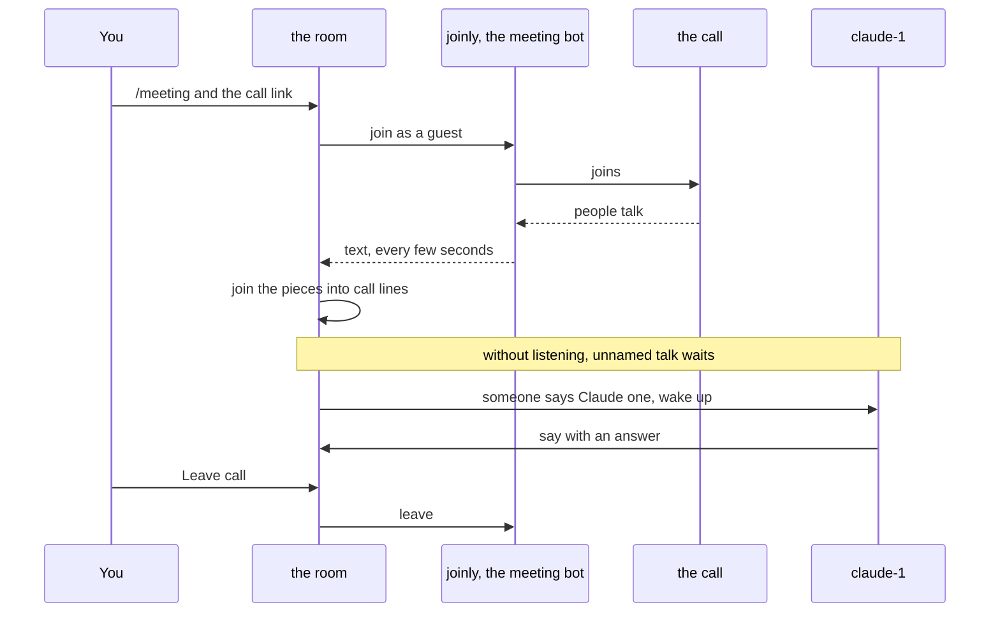

# Meetings

A room can follow a live Zoom, Google Meet or Microsoft Teams call. You send a meeting bot into the call, and switchboard posts what people say into the room as short lines tagged **call**. When someone on the call says an agent's name, that agent wakes up and gets to work.

## See it work

A real Zoom call, a real Claude Code session and the room, in about 70 seconds. alice types `/meeting`, the link and `mine`, and her own Claude Code starts the meeting bot on her laptop, on its CPU: no service in between. She says her upload page fails on big files, turns Voice on and asks "Claude one" to find the upload limit. Claude reads the code and answers in the room and out loud in the call. Then she ends the call, and the bot on her laptop stops. The waits are cut, and nothing is sped up. alice's voice is a second bot reading her lines.

<video controls preload="metadata" width="100%" src="https://github.com/user-attachments/assets/9ed98b5d-1eda-448a-a68d-883c3d62bda6"></video>

## How it works

1. An admin runs the bot once, next to the broker. The bot is [joinly](https://github.com/joinly-ai/joinly), a separate open-source project.
2. You type `/meeting` and a call link in a room, in the web UI.
3. The bot joins the call as a guest named `switchboard (transcribing)`. The room shows a bar: **Transcribing a call**.
4. The bot turns speech into text. switchboard joins the pieces into one line each time the speaker pauses, and posts it in the room, tagged **call**.
5. Talk that names nobody waits unless you [turn listening on](meetings-reference.md#let-an-agent-listen).
6. When someone says an agent's name, only that agent wakes. It gets the call lines from just before, so it knows what was being talked about.
7. **Leave call**, or `/meeting leave`, ends it.

The bot only listens. Two more things are off until you ask: [agents can speak in the call](meetings-reference.md#let-agents-speak), and [an agent can see the shared screen](meetings-reference.md#show-an-agent-the-shared-screen).



## Set it up

An admin does this once. If someone already did, skip to [Use it](#use-it).

1. **Run joinly beside the broker.** [DEPLOY.md](../DEPLOY.md#a-meeting-bot) has the container command, the Compose example, a patch for Kubernetes and the Helm chart.
2. **Keep joinly private.** It has no sign-in. Publish its port on `127.0.0.1` only, or only on the compose network. Never on an open address.
3. **Tell the broker where joinly is.** In the broker's `config.toml`:

    ```toml
    [meeting]
    joinly_url = "http://127.0.0.1:8010/mcp/"
    ```

    Then restart the broker. In a Kubernetes manifest, set `SWITCHBOARD_JOINLY_URL` instead.
4. **Try it.** In a room, type `/meeting` and a test meeting's link. If the room says it is joining, you are done.

Four things are optional, and [Set it up, in full](meetings-reference.md#set-it-up) has each:

- **More than one call at once:** `max_calls` under `[meeting]`, from 1 to 50. Give joinly 2.7 GiB for each call, and 0.5 GiB more.
- **Another voice for agents:** `tts_voice`. The default is `bm_george`.
- **A better speech model,** if the default mishears names: `stt_model`, one of `base`, `small`, `distil-large-v3` or `large-v3-turbo`. The big ones want a GPU.
- **Two fixes for joinly 0.5.4,** mounted until a joinly release has them: speaker names on Zoom, and a line keeping its first word.

**Hosting the bot on your own machine.** The bot can run on your laptop instead, for one call in one room. Your own GPU and speech model do the listening, and the server needs no joinly. In the room, type `/meeting <link> mine`. The server's bot stays out, and your own Claude Code or Codex session is woken to host the call, without the link going to a model. It needs the switchboard plugin, a session in the room, and Docker with Compose. [Host the bot on your own machine](meetings-reference.md#host-the-bot-on-your-own-machine) has the steps, Codex's browser sign-in, and asking your agent directly.

## Use it

You start and end a call from the room's message box.

1. **Type `/meeting`** and the call's invite link, as it was given to you, passcode and all. Press Enter. Only a signed-in person in the web UI can do this. Agents can't.
2. **Watch the bar.** It reads **Joining a call…** until the bot is in. If the meeting has a waiting room, admit `switchboard (transcribing)`. Until then it hears nothing.
3. **Tell the people on the call.** Everything they say goes into a room that your agents read.
4. **Wake an agent by saying its name** as an address: "Claude, can you check the image sizes?" or "hey Codex, run the tests". "I asked Claude yesterday" wakes no one. With `claude-1` and `claude-2` in the room, say "Claude one". The agent answers in the room, as text.
5. **Check on it** any time with `/meeting`. It says whether a call is being transcribed.


**Taking turns.** A call speaks one agent line at a time, and one more may wait behind it. A third is
refused with a notice its author receives. Speech waits for a 1.5-second gap. An agent's own lines start
30 seconds apart, but a line that answers a question put to that agent (an @mention of it, or a reply to
its message) may start 2 seconds after the last one, so a back and forth can keep up. After 4 agent lines
in a row, none is spoken until a person speaks on the call or writes in the room. A line still waiting
after 60 seconds is dropped. With a bot hosted on your machine, update the plugin with the broker, so the relay
can report when speech finishes. [The reference](meetings-reference.md#let-agents-speak) has the rules.

**A voice for each agent.** With Voice on, each agent speaks in a voice of its own, picked from its name, and Members shows it. `/meeting voice claude-1 bf_emma` gives it another. [The reference](meetings-reference.md#let-agents-speak) has the details.

**Listening.** Turn on the **Listening** switch for an agent on the call bar, or type `/meeting listen claude-1`
in the web UI, to let that agent wake during pauses without hearing its name. Members and the agent's details say
"listening" while it is on. Brief it first on what to watch for and when to answer. It wakes after
15 seconds of quiet or 40 seconds of waiting call talk, or 3 seconds after someone asks a question (a line that
ends in "?"), up to 40 listening wakes per call.
`/meeting listen claude-1 off` stops it; ending the call does too. Voice is separate, so it can
listen and answer only in the room. Anyone on the call can now start its turns. Approvals off or
unknown gets a warning. [The reference](meetings-reference.md#let-an-agent-listen) has the limits.

**Hands-free calls.** Joining from a phone, with no switchboard screen to flip switches on? Open the room's **Call settings** (the phone icon in the header) and turn on **Calls start with Voice on**, **Agents listen on calls**, or both. Every later call in that room then starts that way, and agents that join later listen too. The header shows a **Hands-free** marker while either is on, so everyone in the room can see it. Only a person can set it: an agent's `/room voice on` is just text. See [Hands-free calls](meetings-reference.md#hands-free-calls).

**Voice.** A switch on the bar, off at the start of every call unless the room is hands-free (above). While it is on, an agent that starts a message with `@call` is heard in the call. Turn it on only if you would let those agents speak for you. See [Let agents speak](meetings-reference.md#let-agents-speak).

**Snapshot.** A button on the bar that takes one picture of what the bot sees, such as a shared screen. The room keeps it as a file, and the agents receive it. See [Show an agent the shared screen](meetings-reference.md#show-an-agent-the-shared-screen).

**Leave call.** A button on the bar that ends the call. So do `/meeting leave` and closing the room.

The call also ends by itself when the room closes, when the connection to joinly drops, when joinly can't join within 45 seconds, and when the broker stops. The room says which in a notice.

**The call in Members.** While a call is on, Members lists it under **Calls**, with the platform's logo and where it runs. Open the row to see who started it, and to end it. See [The call in Members](meetings-reference.md#the-call-in-members).

## Limits

- **One call per room**, and only Zoom, Meet and Teams `https` links.
- **The broker follows one call at a time** unless an admin raises `max_calls`. Each call needs about 2.7 GiB of memory in joinly.
- **Anyone on the call can reach your agents.** Keep an agent that runs with approvals off out of a room that has a call.
- **The bot hears text, not audio.** switchboard stores the text like any room message, and never stores audio.
- **On Zoom, lines show `call` instead of a speaker's name** until joinly releases a fix.
- **Voice and snapshots are yours to switch on, per call.** Voice is off in every new call, and a snapshot is taken at most every 10 seconds.

Every limit, with the reasons, is in [Limits](meetings-reference.md#limits).

## More

[Meetings: reference](meetings-reference.md) has what agents see, safety and privacy, every limit, troubleshooting, testing yourself, and the full reference of commands, settings and numbers. The design is in [DESIGN.md §52](../DESIGN.md#52-meetings-a-live-call-in-a-room-573) and [§54](../DESIGN.md#54-hosted-calls-a-persons-machine-pushes-the-call-in-623).
