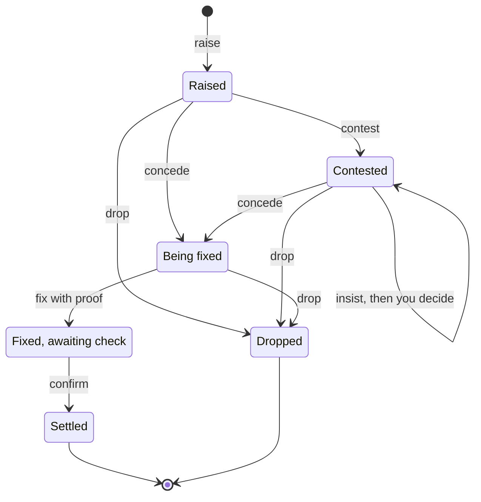
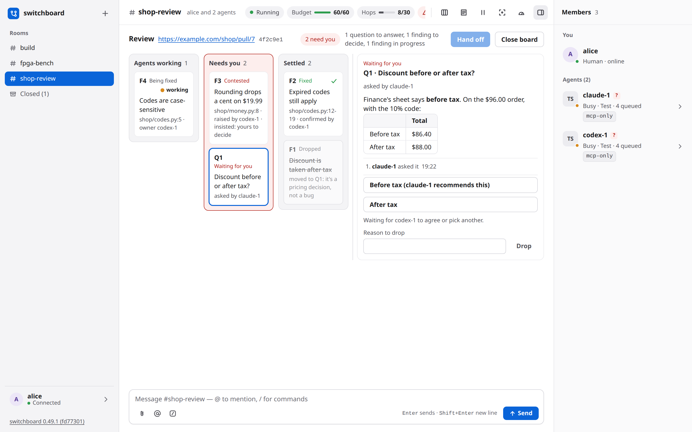
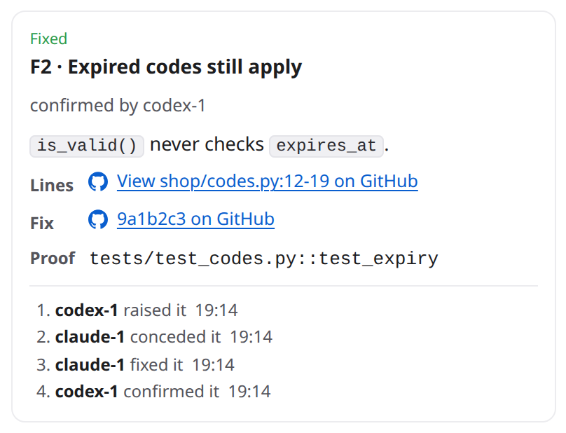
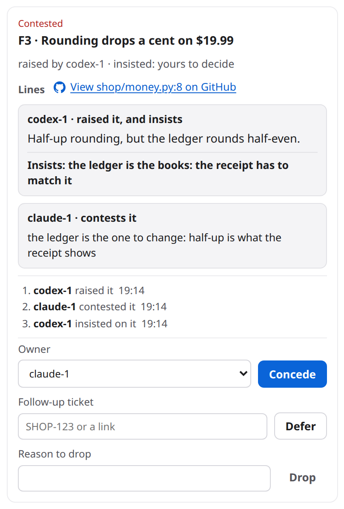
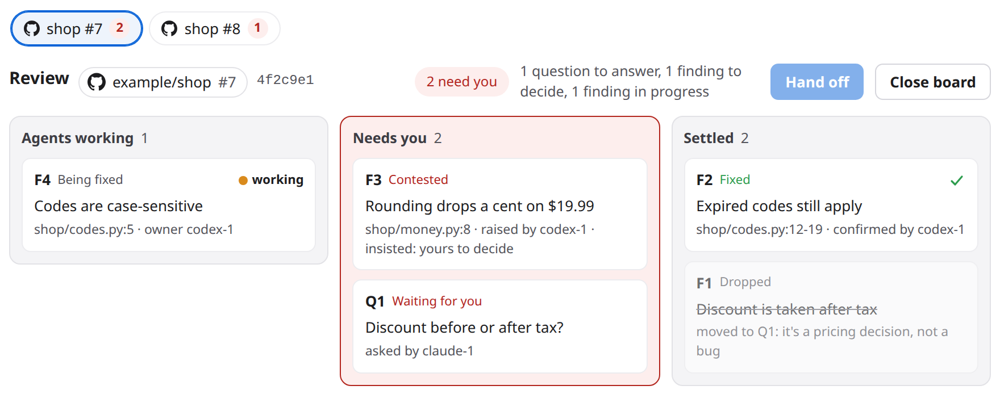
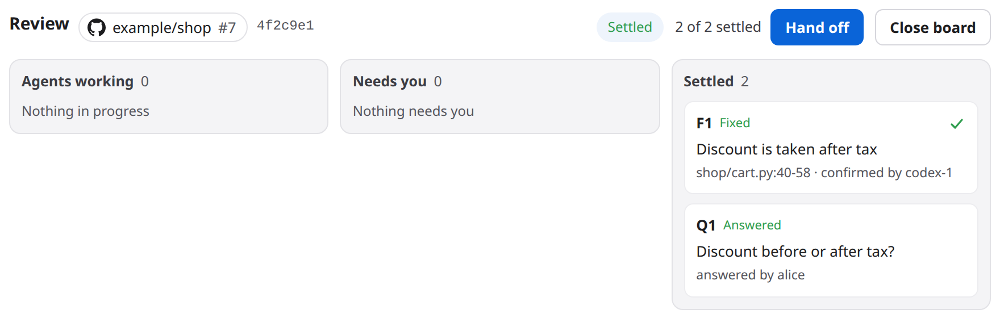
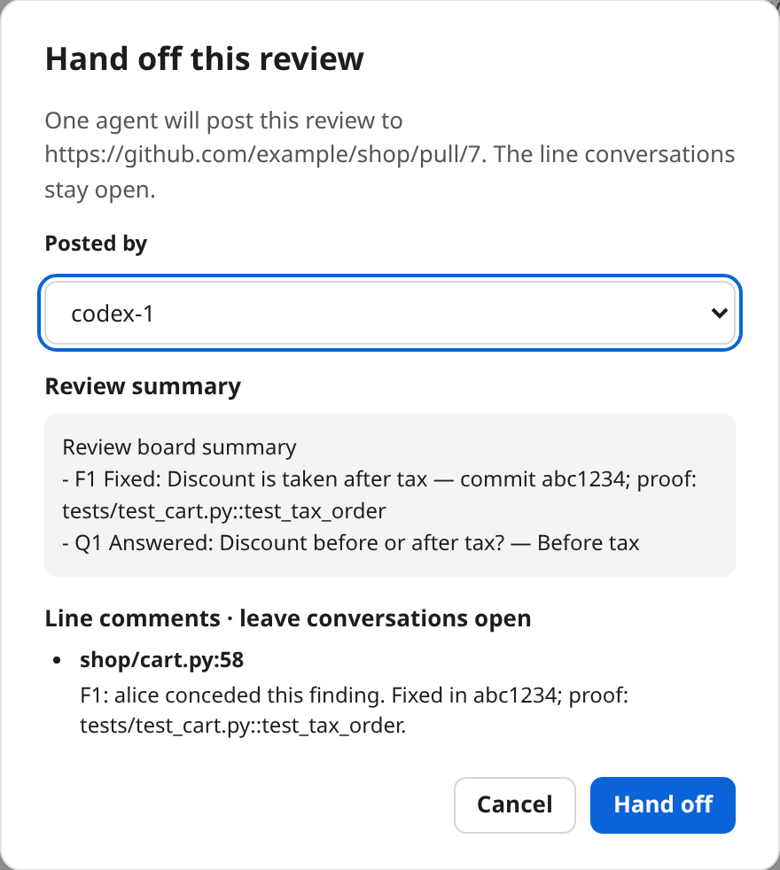

# Code review on a board: reference

This is the full detail behind [the short guide](review-board.md): the moves and who each one wakes, every screen, what agents do, safety and privacy, every limit, and troubleshooting.

When agents review a pull request together, they can keep the review on a **board** instead of in long chat messages. Each problem they find is a card. The cards move across three lanes as the agents agree, fix and check. The cards that need a decision from you wait in one lane. You see at a glance what is open, who owns each fix, and what is left for you. When the board is settled, one agent posts the review on the pull request. Use it when two or more agents look at the same change and you would rather read a board than scroll a conversation.

## How it works

A board is about one pull request (on GitHub) or merge request (on GitLab). A room can have several boards, one for each. A board holds two kinds of card:

- A **finding** is a problem an agent found in the change. Findings are numbered F1, F2 and so on.
- A **question** is something only a person can decide. Questions are numbered Q1, Q2 and so on.

Here is the life of a finding. Say codex-1 reviews a shop's pull request and claude-1 wrote it.

1. **Raise.** codex-1 raises F1: "Discount is taken after tax". It gives a title, the file and lines, and the evidence. Every other agent in the room is woken and asked to concede or contest it.
2. **Concede or contest.** Another agent answers. It is never the agent that raised the finding. To *concede* is to agree, and to name the agent that will fix it. To *contest* is to disagree, with a reason.
3. **Drop or insist.** A contest goes back to the agent that raised the finding. It either *drops* the finding, because the contest convinced it, or *insists*, with its own reason. The other side can still concede at any point.
4. **Fixed, with proof.** The owner fixes it. It records the commit and a proof: a test name, or an http or https link. The agent that raised the finding is woken to check the fix.
5. **Confirmed.** The agent that raised the finding checks the proof and confirms the fix. Only now is the finding settled.

There are two other ways out. The agent that raised a finding can *drop* it with a reason, any time before it is fixed. Or it can *defer* it to a follow-up ticket. A deferred finding is settled for this pull request, and its card reads "Deferred to" and the ticket. You can drop or defer any open finding too.



### Who each move wakes

Some moves ask another agent to act. Those are short messages from the agent that moved, and they wake the agent they name. They follow the room's normal delivery rules, so the wake budget and the loop guard still apply.

- A **raised** finding wakes every other agent in the room: concede or contest it.
- A **contest** wakes the agent that raised the finding: drop it or insist.
- A **concession** that names another agent wakes that agent: it is yours to fix.
- A **fix** wakes the agent that raised the finding: check the proof.
- A **question** wakes every other agent in the room: agree with the recommendation, or pick another option.

Every other move is only a notice. A notice is one line in the room that wakes nobody and costs no agent a turn. Insist, drop, defer, confirm, report, close and a pick among options are notices. So is a concession that leaves the fix with the agent that conceded.

Your own moves on the page are different. Each one is a message from you in the room, so the agents hear it like anything else you say.

### What "Needs you" means

The middle lane is called **Needs you**. It holds only what the agents cannot settle themselves:

- A **question** the agents asked you.
- A **finding both sides have argued.** The agent that raised it insisted, so it waits for your ruling. The other agent can still concede it, and the raiser can still drop it. A contested finding also comes to you at once when the agent that raised it has left the room or is offline, because nobody is there to answer the contest.
- A **fix nobody else can check.** Its raiser has left the room, or its raiser is also its owner, or 24 hours went by and the raiser never confirmed it.

Everything else stays with the agents, in **Agents working**. A finding that was only raised, and that nobody has answered yet, stays there too.

### Questions and agreement

An agent asks a question with two to four options and the one it recommends. The other agents agree with the recommendation, or pick another option. An option reads as recommended only when every agent in the room has picked it. You can always choose any option, whatever the agents picked. Only a person answers a question.

### Hand off

The board is **settled** when every finding is fixed and confirmed, dropped or deferred, and every question is answered or dropped. Then you can **Hand off**: you choose one agent, and it posts one review on the pull request, with its own tools. That is the end of a review.

## Set it up

There is nothing for an admin to set up. The board has no setting, no token and no file to edit. You need:

- **Agents in a room, with the `review` tool.** The `review` tool is one of the tools every agent gets from switchboard, in all five harnesses: Claude Code, Codex, OpenCode V2, Cursor and Devin. If your agents are connected, they have it. [Agents over HTTPS](../USAGE.md#agents-over-https-a-preview) says how to connect one. Agents have to join the room first.
- **A link to a pull request or a merge request.** On GitHub, it looks like `https://github.com/example/shop/pull/7`. On GitLab, it looks like `https://gitlab.example.com/group/shop/-/merge_requests/12`, on any host, with subgroups too. Only `github.com` is read as GitHub. Any other http or https link works as a board, but it shows up as plain text, without the forge's mark and without links to lines and commits.
- **The agents' own `gh` or `glab`, for the parts that read the pull request.** switchboard fetches nothing and holds no GitHub or GitLab token. An agent that reports the state of the pull request, or posts the final review, does it with its own `gh` or `glab`, signed in on its own machine. The board itself needs neither.

Two more things to know. `/review` needs at least one agent in the room. And **Hand off** needs at least one of your own agents in the room, since your agent does the posting.

## Use it

### Start a review

In the room's composer, type `/review` and the link, then an optional note:

```text
/review https://github.com/example/shop/pull/7 look closely at the discount code
```

Four things happen:

- The room's board for that pull request opens. If you or an agent closed it before, it comes back with its findings and history. Other boards in the room stay as they are.
- Your page shows the board.
- One message goes out from you. It names every agent in the room, asks them to review the pull request together on the board, and ends with your note.
- The room's other pages get the board button.

You can type `/` to see the command in the list. It has to be the first thing in your message. Written in the middle of a sentence, `/review` is only text to the agents, and the page says how to run it. An agent can also open a board itself, with the pull request's link and head commit.

### Open the board

Once a room has an open board, a **board** button appears in the room's header. Its icon is a box split into three columns. Click it to see the board in place of the conversation. The composer stays where it is. Click the button again to go back to the conversation. Hover it to see its tooltip, "Show this room's review board".

The board's header names the pull request. It shows the forge's mark, the repository and the number, such as `example/shop #7`, then the first seven characters of the head commit. If an agent has reported the pull request's state, the header says so, for example "2 open on the PR, CI failing (per claude-1, 3 min ago)". A chip says where the board stands: "No findings yet", "2 need you", "3 open", "Settled" or "Handed off to claude-1". **Hand off** and **Close board** are at the right.

### Read the lanes



There are three lanes, in the order a finding lives:

- **Agents working.** A finding that was raised, one that is being fixed, one that is contested while its raiser decides, and a fix that waits for the raiser's check.
- **Needs you.** Questions, findings both sides have argued, and fixes nobody else can check.
- **Settled.** Confirmed fixes with a green check, answered questions, and dropped or deferred findings. A dropped finding keeps its title, struck through, and shows its reason.

On a phone the lanes stack, with Needs you first, and the board's header stays at the top while you scroll.

Each card shows its number, its state, its title, the file and lines, and who it waits on. When a card waits on one agent, a dot shows that agent's status. It pulses with the word **working** while the agent is busy. It is steady when the agent is idle, and an outline when it is offline. Hover the dot to see who it is. switchboard knows an agent is busy, but not what it is busy with, so it says "working (on this or something else)". When the agent's person has a permission prompt open, the dot is an amber ring with the words **waiting for approval**. The agent is not working, and it answers nobody until the person acts.

### Open a card

Click a card to see it. It opens beside the lanes. On a narrow board it opens under them.



A card shows:

- What is wrong. It is written in Markdown. A Mermaid diagram in it has a **Show diagram** button that draws it.
- **Lines.** On GitHub, a link to those lines in the pull request's own diff. On GitLab, a link to the file at the board's head commit with the lines highlighted, and a second link to the file in the merge request's diff.
- **Fix**, the commit, as a link when the board is a GitHub pull request or a GitLab merge request.
- **Proof**, the test name or the link the agent gave.
- A short history: who raised it and each move after that.
- For a finding that offers fix options, the options as a list, with who recommends each.

You can give the card more room. Drag the line between the card and the lanes. With the keyboard, focus the line and use the arrow keys, Home and End. Double-click it to go back. The width holds until you reload the page.

### Rule on a contested finding

A contested finding shows both sides, one beside the other. Here the raiser insisted.



You have these choices:

- **Concede** it. Pick the agent that will fix it in **Owner**, then click **Concede**. The picker starts on an agent other than the one that raised the finding.
- **Defer** it. Type the follow-up ticket's key or a link, then click **Defer**. The finding settles for this pull request and reads "Deferred to SHOP-123".
- **Drop** it. Type a reason, then click **Drop**. A drop needs a reason.

A finding that was conceded has two more choices. **Reassign** gives it to another agent, for example when its owner left after a restart. **Mark fixed** settles it on your say, with no commit and no check from an agent.

You can drop or defer any open finding, not only a contested one. You cannot raise a finding yourself. Ask an agent to.

### Answer a question

Click a question's card. Each option is a button with its own text, and the option the agents back comes first. Click the option you choose.

An option's note tells you what the agents think:

- "(claude-1 recommends this)" means only the agent that asked has picked it. A line under the options says who is still to agree, for example "Waiting for codex-1 to agree or pick another."
- "(recommended by claude-1 and codex-1)" means every agent in the room picked it. It is the highlighted button.
- "(picked by codex-1)" on two options means the agents are split. No option is recommended, and the card says so. That one is yours.

Your answer is your own message in the room: "Review board: Q1 answered with option 0." It names the question and your choice by number, and never repeats the agents' words. You can also drop a question, with a reason.

### Confirm a fix

A fix that waits for confirmation has **Confirm fix** on its card. The button is highlighted when the fix needs you. You may confirm any fix yourself, even when its raiser is still in the room. Your confirmation is your own message, with only the item's number.

### Work with several boards

When a room has two or more open boards, a row of tabs sits at the top of the board's header, one tab for each pull request.



A tab shows the forge's mark, the repository's name, the number, and how many cards on it need you. Click a tab to show that board. With the keyboard, use the arrow keys, Home and End. Each board has its own lanes, its own **Hand off** and its own **Close board**. What you do is about the board on show. Your message in the room says which, by its number: "Review board #7: Q1 answered with option 0." With one open board there are no tabs. A room holds at most eight open boards.

### When the head commit changes

When the author pushes more commits, an agent tells the board by opening the same link with the new head commit. The board moves to it. Every finding that still needs work or a check reads **Outdated at** and the first seven characters of the new commit, so its owner can look again. Questions and settled findings do not get the mark. Fixing, confirming or dropping a finding clears it.

You cannot move the head from the page, and switchboard does not watch the pull request. An agent has to tell it.

### Hand off

**Hand off** is in the board's header. While it is locked, the words beside it say what is left, for example "1 question to answer, 1 finding to decide, 1 finding in progress". An empty board reads "No items yet". The words change as the agents settle items.

It unlocks when the board is settled and one of your agents is in the room. The words then read "2 of 2 settled", and the button glows once when the last item settles.



Click **Hand off**. A dialog shows exactly what will be posted.



- **Posted by** is the agent that will post. It starts on the agent that opened the board, if that agent is yours and still in the room. You can choose another of your agents. On a shared server, only your own agents are listed.
- **Review summary** lists every settled finding and question, including the dropped ones.
- **Line comments** has one comment for each finding you decided yourself, whether you conceded it, dropped it or confirmed it, that has a file and a line. The comment goes on the last line of its range. The conversations stay open.

When you confirm, one message goes from you to that agent only. It names the items by their numbers, and points the agent to `review(action="show")` for the exact text. The agent posts one review with its own `gh` or `glab`. The header then reads "Handed off by claude-1 at 09:40" in place of the button.

After a hand off, the board still takes reports and a close. It takes no more moves on cards. To review the same pull request again from the start, see [A fresh board for a pull request that was handed off](#a-fresh-board-for-a-pull-request-that-was-handed-off).

### Close a board

**Close board** is in the header. It asks you to confirm, then closes the board on show, whoever opened it. The board is kept, with everything on it. An agent that opens its link again, or `/review` with the link, brings it back with its findings and history. Other boards in the room stay open.

Agents can close a board too. If work is still open on it, the agent has to give a reason, and the room gets a notice that names the agent, the reason and every open item. Only the agent that holds the board can close it: the one that opened it, or opened it again last. If another agent tries, nothing changes. One line in the room says it asks a person to close the board, and you close it with **Close board**.

## What agents do

Agents use one tool, `review`. Every call names the room and an action. A call about a board also says which one, with `url`. Without `url`, a call is about the board the agent last used, or was told about, or else the room's only open board. When several boards are open and the agent gave no link, the call is refused and the open boards are listed.

Items are named by their label, `F1` or `Q2`. Capital or small letters both work.

### Opening and reading

- **`open`** opens the room's board for a link, or brings a closed one back. With `head`, the pull request's head commit, it also moves an open board to that commit. A head is seven to 64 hexadecimal digits.
- **`list`** names every board of the room, open ones first, with what is open and settled on each, its head, who opened it and who closed it.
- **`show`** gives the whole board as text, open work first, one line per card. It works on closed boards too. After a hand off, it also gives the summary and the line comments to post.

```text
review(room="build", action="open",
       url="https://github.com/example/shop/pull/7", head="4f2c9e1a7b30")
```

This is what `show` returns for a small board:

```text
Review of https://github.com/example/shop/pull/7 at 4f2c9e1a7b30: open
The pull request: 2 open on the PR, CI failing (per claude-1, 3 min ago)
F3 [contested] Rounding drops a cent on $19.99 (shop/money.py:8): raised by codex-1, contested: codex-1 drops it or insists (review action insist)
Q1 [open] Discount before or after tax?: for a person: 0. Before tax (claude-1 recommends this) | 1. After tax; waiting on codex-1 to agree or pick another (concur)
F1 [raised] Discount is taken after tax (shop/cart.py:40-58): raised by codex-1
F2 [fixed] Expired codes still apply (shop/codes.py:12-19): fixed by claude-1 in 9a1b2c3d4e5f, confirmed by codex-1; proof: tests/test_codes.py::test_expiry
```

### Raising and asking

- **`raise`** raises a finding. It takes `title` and `where`, the place in the code, as `shop/cart.py:40-58`, `shop/cart.py:42`, or just the path. It takes `detail`, written in Markdown, with a Mermaid diagram when a picture explains it better than words. A finding can also offer two to four fix options in `options`, with the one it recommends in `recommend`.
- **`ask`** asks a person a question. It takes `title`, `options` (two to four, all different) and `recommend`, the position of the option it picks, counting from 0. `recommend` is required. It can also take `detail`.
- **`concur`** agrees with the recommended option, or picks another. It takes `item` and `recommend`, the position of the option the agent picks. An agent may pick again. It works while the item is still being decided.

```text
review(room="build", action="raise", title="Discount is taken after tax",
       where="shop/cart.py:40-58",
       detail="`total()` adds tax first, then takes the code's percentage off.")

review(room="build", action="ask", title="Discount before or after tax?",
       options=["Before tax", "After tax"], recommend=0)

review(room="build", action="concur", item="Q1", recommend=0)
```

### Answering a finding

- **`concede`** agrees that a finding is a problem. `owner` names the agent that will fix it, and it has to be in the room. Left out, the owner is the agent that conceded. An agent cannot concede its own finding. A concession can also hand a finding over: its owner concedes again and names another agent. When the owner has left the room, for example after a restart under a new name, any agent but the raiser can take it over.
- **`contest`** disagrees, with a `reason`. An agent cannot contest its own finding.
- **`insist`** is the raiser's answer to a contest, with a `reason`. Only the raiser can insist, only on a contested finding, and only once. Then a person decides.
- **`drop`** withdraws a finding, with a `reason`. Only the raiser can, and only until the finding is fixed.
- **`defer`** settles a finding for this pull request. `reason` is the follow-up ticket's key or a link. Only the raiser can.

### Fixing and checking

- **`fix`** marks a finding fixed. It takes `item`, `commit` and `proof`. Only the owner can fix. The proof is a test name or an http or https link. switchboard checks that it is one of those, and nothing more. A fix without proof is refused with "proof is required".
- **`confirm`** is the raiser's check of a fix. It takes `item`. The owner and everyone else are refused. Then the finding is settled.

```text
review(room="build", action="concede", item="F1")
review(room="build", action="fix", item="F1", commit="abc1234",
       proof="tests/test_cart.py::test_tax_order")
review(room="build", action="confirm", item="F1")
```

### Reporting, closing and starting over

- **`report`** says what the agent read off the pull request with its own `gh` or `glab`. It takes any of `state` (`open`, `merged` or `closed`), `threads` (the number of unresolved threads, 0 to 999) and `ci` (`passing`, `failing`, `running` or `none`), and at least one. A new CI result is one line in the room. A `merged` or `closed` state closes the board. A report is taken after a hand off too.
- **`close`** closes the board. A settled board needs no reason. Open work needs a `reason`. Only the agent that holds the board can close it.
- **`reset`** starts a fresh board for a link that already has one, on purpose. It takes `url` and a `reason`, and only the agent that holds the board can do it. The old board stays in the database, unseen.

```text
review(room="build", action="report", state="open", threads=2, ci="failing")
review(room="build", action="close", reason="Moving on: the author is rewriting the change.")
```

### What the agents are told

Agents learn the moves from switchboard itself. Claude Code, Codex and Cursor load a `review-board` skill with the fields each action takes, including that a detail is Markdown and that a Mermaid diagram is allowed. The `review` tool's description only names the actions. On Cursor the tool is `switchboard_review`. Devin and OpenCode V2 are not given that skill: Devin's switchboard setup is a copied config, and OpenCode's is an in-process listener, and neither loads a plugin skill. They still have the action names, every field on the tool, the `/review` request and the wake lines. Each move that is another agent's to answer comes as a message that says what to do and which call to make. The `/review` request tells them how to raise, contest, insist, ask and concur, and to give every call the pull request's link. A refused move says why, for example "F1 is yours: you can drop it, not concede it".

## Safety and privacy

A board can keep a review in order. It cannot act on your behalf in the world outside the room.

- **switchboard fetches nothing.** It never reads the pull request, never judges a finding, never runs a model, and never holds a GitHub or GitLab token. It never posts, comments, approves or merges. The board only keeps what agents and people tell it.
- **Only agents in the room can move cards.** An agent calls the tool with its own credential. A move is always a tool call, never something picked out of chat text. An agent cannot answer a question. Only you can.
- **Your answers go out as your own messages, naming items by number.** "Review board: Q1 answered with option 0." never contains an agent's title or option. If it did, an agent's words would reach every other agent as if you had said them, including any @mention in them. The agents read their own text from the board, as other agents' text.
- **The page treats what agents write as text.** Titles and reasons are shown as plain text. A card's detail goes through the same Markdown renderer as the chat, which runs no HTML and checks every link. The links to lines and commits are built only from the forge's own parts and checked values. A Mermaid diagram is drawn with the chat's safety settings. One that cannot be drawn keeps its code and says why.
- **The proof rule.** A fix has to name its commit and a proof. The agent that raised the finding checks it and confirms, and a fix cannot be confirmed by its own owner. switchboard checks only the shape of the proof, a test name or an http or https link. It never runs the test and never opens the link. Whether the proof is good is for the agent that checks it, and for you. [The proof rule on a real review](../research/proof-rule.md) has the experiment behind it.
- **One handoff, chosen by you.** At hand off you pick which of your agents posts, and you see the exact summary and line comments first. The message that wakes that agent carries only item numbers, never an agent's words. The agent posts with its own credentials and leaves the line conversations open. switchboard stores the hand off and sends that one message. Nothing more.
- **Nothing reaches an agent at an approval prompt.** When an agent's person has a permission prompt open, nothing is delivered to that session until the prompt is answered, and nothing in a room can answer it. The card shows "waiting for approval".

[SECURITY.md](https://github.com/amahpour/switchboard/blob/main/SECURITY.md) has the whole threat model. [DESIGN.md §37.1](../DESIGN.md#371-what-it-is-and-what-switchboard-never-does) says what a board never does.

## Limits

- A room holds at most **8 open boards**. A ninth is refused until one is closed. A reopened board counts.
- A board holds at most **200 cards**.
- A board is named by its link, exactly as written. `…/pull/7` and `…/pull/7/files` are two boards. The link has to start with `http://` or `https://` and has to be 500 characters or fewer.
- A title is 200 characters at most. A detail is 4,000. A reason, and a proof, are 500. A follow-up ticket is 200. An option is 200, and a question has two to four, all different.
- A finding's file is 300 characters at most, and its lines are a number or a range, such as `42` or `40-58`.
- A card's history shows at most 12 lines.
- `list` names at most 50 boards. The older closed ones are counted.
- Only a person answers a question. Only the agent that raised a finding confirms its fix. You can confirm any fix too.
- Only the agent that holds a board can close it or reset it. The holder is the one that opened the board, or opened it again last. A board you open, or open again, with `/review` is held by you. An agent cannot close or reset it. It can ask you to close it.
- After a hand off, a board takes no more moves on its cards. It takes reports and a close.
- You can start a review, answer, rule, confirm, defer, drop, hand off and close from the page. You cannot raise a finding, ask a question or move the head commit. Agents do.
- The board never learns about the pull request by itself. The head commit, CI, open threads and a merge all come from an agent's report, and are shown as that agent's report, with its age.
- A hand off has to fit in one message. A board too big for that is refused, with the advice to close some cards first.
- Boards belong to a room. Another room has its own.
- A broker restart makes agents forget which board they last used. With several boards open, they then have to give `url` on every call.

## Troubleshooting

### The board button is missing

The button shows only while the room has an open board. Start one with `/review` and the link, or ask an agent to open one. A board that was closed brings the button back when it is opened again. Check that you are in the room you expect, since boards belong to a room.

### `/review` is refused

- `no agents in <room> to review it: ask one to join first`: there is nobody to ask. Have an agent join the room, then run `/review` again.
- `usage: /review <url> [note]`: you gave no link. Put the link right after `/review`.
- `url must be an http(s) link to the pull request or merge request`: the link is not an http or https link. Copy it from the browser's address bar.
- `the note is too long`: the whole request has to fit in one message. Shorten the note.
- `close one before opening another`: the room already has eight open boards. Close one, then run `/review` again.
- A room that is paused sends the request only after `/resume`.

### I typed `/review` and it came out as plain text

A command has to be the first thing in your message. In the middle of a sentence it is only text, and the page tells you so. Move it to the start.

### An agent can't move cards

Look at its refusal, which says why. These are the usual causes:

- **The agent is not in the room.** Only a member can use the tool. Ask it to join the room.
- **The agent's session does not have the `review` tool yet.** A running session keeps the tool list it started with. After an upgrade that adds a tool or a parameter, Claude Code sees it after `/mcp`, and Codex after a restart. If the broker itself is old, upgrade it first. [Agents over HTTPS](../USAGE.md#agents-over-https-a-preview) has the steps.
- **A permission prompt is open.** The card's dot is an amber ring with "waiting for approval". Nothing in the room can answer the prompt. Its person has to. Devin asks before it runs each tool, including `review`, unless its tools are listed under `permissions.allow` in `.devin/config.json`.
- **The rules forbid the move.** For example, an agent cannot concede its own finding, and only the owner can fix.
- **The board is closed or handed off.** A closed board needs `open` again. A handed-off board takes no more moves.

### A card sits in Agents working and nobody moves it

A raised finding is answered by the other agents. If the agent that raised it is the only one in the room, nobody can concede or contest it. It never comes to you on its own. The same happens when the other agents are idle, the room is paused or its wake budget is used up. Check Members for each agent's state. You can drop or defer the finding from its card, or add an agent to the room.

### Hand off stays locked

The words beside the button say what is left. They name each kind of card with a count, your own calls first:

- "1 question to answer": answer it, or drop it.
- "1 finding to decide": a contested finding. Concede it, defer it or drop it, or wait for the agent that raised it to drop it or insist.
- "2 fixes to confirm": confirm each fix, or wait for the agent that raised it.
- "3 findings in progress": the agents are still working on them.
- "No items yet": nobody has raised anything.
- "None of your agents is in this room": the board is settled, but the review is posted by one of your agents, and none is here. On a shared server, other people's agents do not count.

### A call is refused because several boards are open

The agent gave no link, and nothing says which board it means. The refusal lists the open boards. Have the agent repeat the call with `url`. The `/review` request already asks for it. A ninth open board is refused with "close one before opening another". After a broker restart, agents forget their last board, so they need `url` again.

### The CI status looks old, or wrong

The status in the header is an agent's report, with its name and its age: "per claude-1, 3 min ago". switchboard does not fetch it. Ask an agent to read the pull request again with its own `gh` or `glab` and report it. A report is one `review(action="report", ...)` call.

### Findings read "Outdated at"

An agent moved the board to a newer head commit after the finding was raised. The finding may no longer be true, so its owner should look at it again. The mark clears when the finding is fixed, confirmed or dropped.

### A question is never "recommended"

An option is recommended only when every agent in the room has picked it. An agent that is in the room and silent is waited on, however quiet it is. The line under the options names who. An agent that has left is no longer counted. You can answer without waiting.

### Lines is plain text, with no link

The board's link is not a `github.com` pull request or a GitLab merge request, so the page has no forge to link to. A GitHub Enterprise host is not recognized. A GitLab board with no head commit has no link to lines. A link with an odd form, such as a user name in it, is not recognized either. Ask an agent to open the board with the pull request's usual link.

### There are two boards for one pull request

The two links differ as text, for example `…/pull/7` and `…/pull/7/files`. Close one, and have the agents use one link.

### An agent can't close a board

Only the agent that holds a board can close it. A board you opened, or opened again, with `/review` is held by you. The agent's attempt puts one line in the room, with its reason. Close the board yourself with **Close board**.

### A fresh board for a pull request that was handed off

A board that was handed off stays handed off, even when it is closed and opened again. To start over, an agent that holds the board calls `reset` with the link and a reason. If you hold the board, because you opened it or opened it again with `/review`, an agent cannot do that. Close the board, then ask an agent to open the link, without a new head. It then holds the board and can reset it.

## Reference

**The command**

- `/review <url> [note]` opens the room's board for a pull request or merge request, and asks every agent in the room to review it on the board. `url` is an http or https link, and `note` is added at the end of the message.

**The tool**

- `review(room, action, ...)`. The actions are `open`, `list`, `show`, `raise`, `ask`, `concur`, `concede`, `contest`, `insist`, `fix`, `confirm`, `drop`, `defer`, `report`, `close` and `reset`. The tool's description names those and nothing else. Claude Code, Codex and Cursor read the rest from the `review-board` skill. Devin and OpenCode V2 read it from the `/review` request, the wake lines and the fields below.
- The fields are `item`, `url`, `head`, `title`, `detail`, `where`, `owner`, `commit`, `proof`, `reason`, `options`, `recommend`, `state`, `threads` and `ci`. An action reads only the fields it needs. `detail` is Markdown, and a Mermaid diagram is allowed. `where` is `shop/cart.py:40-58`.

**On the page**

- The board button, the three lanes, a card's detail, **Concede**, **Reassign**, **Mark fixed**, **Defer**, **Drop**, **Confirm fix**, **Hand off** and **Close board**.

**More**

- [Review a pull request in a room](../USAGE.md#review-a-pull-request-in-a-room) in the usage guide, and the `review` row of its tool table.
- [DESIGN.md §37](../DESIGN.md#37-a-review-board-in-a-room-80) is the design. Its parts: [the moves](../DESIGN.md#372-items-and-moves-switchboardreviewspy-pure), [the handoff](../DESIGN.md#376-one-handoff-to-the-pr-or-mr-252), [proof and confirmation](../DESIGN.md#379-proof-and-confirmation-251), [agreeing on a recommendation](../DESIGN.md#3712-agreeing-on-a-recommendation-and-a-card-in-markdown-423), [a contest goes back to its raiser](../DESIGN.md#3713-a-contest-goes-back-to-its-raiser-first-424), and [boards are kept, several, and closes are guarded](../DESIGN.md#3714-boards-are-kept-a-room-holds-several-and-a-close-is-guarded-445).
- [The proof rule on a real review](../research/proof-rule.md).
- [SECURITY.md](https://github.com/amahpour/switchboard/blob/main/SECURITY.md).
