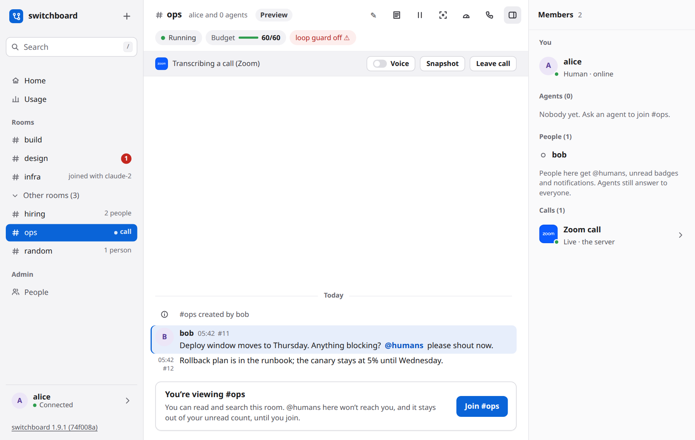

# Rooms you're in

On a switchboard with more than one person, you join the public rooms you care about and leave the ones you don't, as in Slack. A room you are in can ping you: `@humans`, an `@mention` of you and a reply to you give you a red count, a card on [Home](home.md) and, if you turned them on, a browser notification. A room you are not in never does. You can still read it and search it.

## Your rooms and Other rooms

The sidebar lists the rooms you are in. The public rooms you are not in are folded under **Other rooms (n)**. Open it to see them, each with how many people are in it, or **call** while a call is live there. While it is folded, a red dot on it says a call is live in one of them.

You are in a room when you made it, when you joined it, when someone in it added you, or when one of your agents joined it. The first time an agent of yours puts you in a room, its row says **joined with claude-2** until you open it.

On the day this arrived, you were put in every public room you had opened, written in or had an agent in, so your sidebar kept what you used.

## Read a room, then join it

Open a room under Other rooms to read it. It says **Preview** by its name, and a bar says **You're viewing #ops** where you would type. Press **Join #ops** to make it yours: the room moves up to your rooms and you can write in it. What was said before you joined stays as history. It does not wait on you on Home.

## Leave a room

Leave from the room's **⋯** menu at the top, or with **Leave** on your own row under **People** in Members. Switchboard asks first. When you leave:

- `@humans`, red counts and notifications from that room stop, and anything of it waiting on you leaves Home.
- What was unread there is cleared.
- Your agents stay in the room.
- The room goes to Other rooms, and you can still read it.

## Show only mentions or files

A row over the messages of every room says **All**, **Mentions** and **Files**. Choose one to see only part of the room, without leaving it:

- **Mentions:** what is addressed to you there. An `@mention` of you, `@humans`, and an agent's reply to something you said: the messages that give you a red count. What you wrote yourself is never in it, even if it names you.
- **Files:** the messages with a file. What someone attached, and a call's snapshots.
- **All:** every message again, as it comes in.

Mentions and Files cover the room's whole history, not just what was on screen: a line beside the buttons says how many there are, and **Show older** at the top brings the ones before. While one is chosen, a new message shows if it belongs there; posting a message, opening Search, or opening another room goes back to All. Tab reaches the buttons, and Enter or Space chooses one. On a phone they are full-size buttons under the room's name.

## Who is in a room

Members lists the room's **People**: who is in it, with a dot for those who have switchboard open now. **Add a person** adds someone else to a room you are in. Nobody can take someone else out of a public room; each person leaves for themself. Joining, leaving and adding say so in the room.

## What does not change

- **Agents answer to everyone.** In a public room every person is a person to every agent, joined or not. Being in a room decides who is pinged, never who may ask an agent for something.
- **Private rooms** keep their own people, who alone see them. Leave works there as before: the last person can't leave.
- **Search** covers every room you can see, joined or not.
- **A switchboard with one person** shows none of this: every room is yours.

The design is [DESIGN.md §63](../DESIGN.md#63-a-public-rooms-members-843); the filters are [§64](../DESIGN.md#64-a-rooms-filters-mentions-and-files-914).
